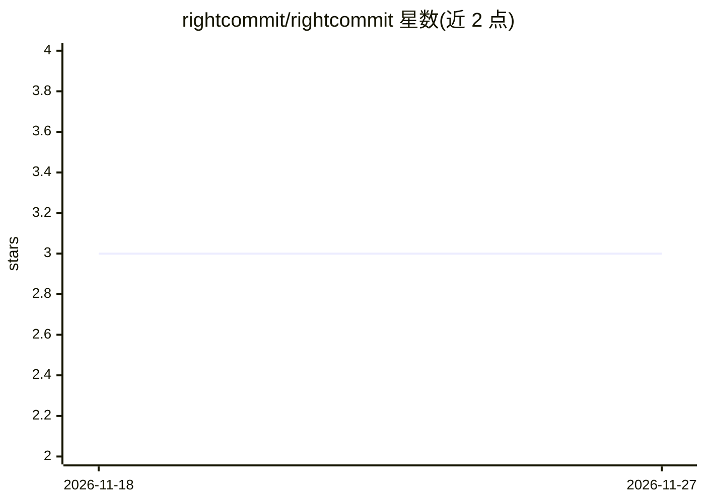

# rightcommit/rightcommit

⭐ 3 · Rust · Apache-2.0 · 推送 2026-11-26 · [GitHub](https://github.com/rightcommit/rightcommit) · [官网](https://rightcommit.com) · 个人维护 · 中文 README

**AI 编码 agent 的自托管工作流引擎：编排运行与成本追踪**

以 Rust 构建的自托管工作流引擎，面向运行 Claude Code、Codex 与 Pi 编码 agent 的开发者与小型团队：在可视化画布上从描述生成可编辑工作流，或使用 20 余个预置工作流；按步骤编排 agent 执行，支持并行步骤、工作流互调、定时运行与 A2A 发布；提供质量门（测试、agent 审查、人工批准）、产物指纹与逐行 diff、从任意步骤重启、交互/辅助/无人值守模式，FinOps 按步骤、运行、agent 与模型记录 token 与成本。安装途径包括 Docker Compose、macOS Homebrew、crates.io 或源码。

## 筛选速览

| 维度 | 判定 | 备注 |
|---|---|---|
| AI 角色 | `ai-ecosystem` | LLM/agent 周边工具 |
| 许可风险 | `permissive` | Apache-2.0 |
| 部署形态 | `self-host` | docker 或自建部署 |
| 模型依赖 | local-ok | 支持本地模型 |
| 硬件要求 | — | 无带数字的原话,不猜 |
| 安装摩擦 | `low` | 无编译、无系统依赖或容器化 |
| 成熟度 | — | 结构信号不足 |

## 能力要点

- 可视化画布编排 agent 工作流，支持并行、互调、定时与 A2A 发布
- 质量门机制：服务器端测试、agent 审查与人工批准后才提交
- 产物记录 SHA-256 指纹与逐行 diff，可从任意节点重启运行
- FinOps 按 step/run/workflow/agent/model 记录 token 与成本估算

## 适用场景

- 把 GitHub/Jira/ServiceNow 工单转成需求、规格与测试并交付代码
- 在服务器上运行安全扫描并让 agent 分诊修复、阻断不合规提交
- 从遗留代码重建行为、规则与测试作为新工作基线
- 小型团队自托管运行 agent 并追踪各模型成本

## 场景标签

`工作流自动化` `编码 Agent` · 领域:效率与自动化

## 证据(README 行号)

> L13:  The open source workflow engine for AI coding agents.
> L15:  Describe the job, get an editable workflow on a visual canvas, and run Claude Code, Codex and Pi through the tests
> L103: - **Agents:** Claude Code, Codex and Pi, with an API key or an authorized gateway (Anthropic,

## 星数曲线

2026-11-18 3 → 2026-11-27 3（+0）

---
*卡片 v1 · prompt 1.4 · 生成 2026-11-21 · 置信度 high · 依据 README sha `ad98fb9268a7` · [字段定义](../../DATASET.md)*
