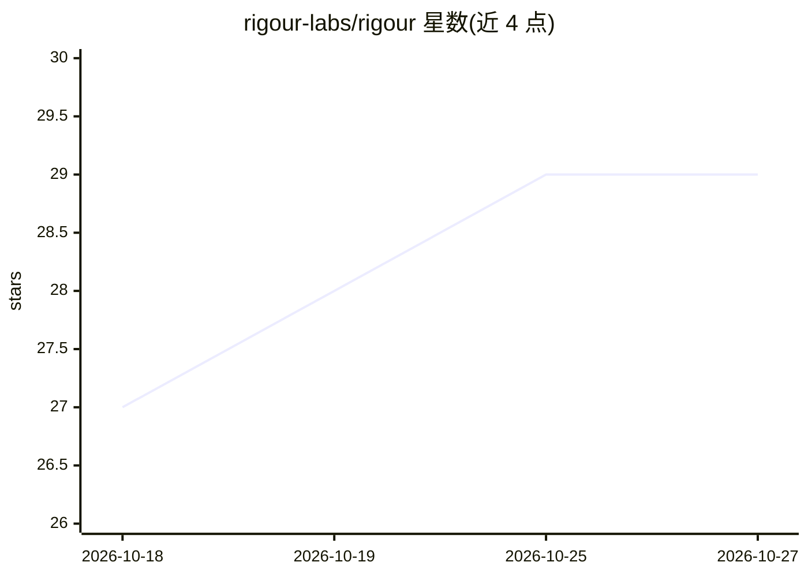

# rigour-labs/rigour

⭐ 29 · TypeScript · MIT · 推送 2026-10-19 · [GitHub](https://github.com/rigour-labs/rigour) · [官网](https://www.rigour.run/) · 组织维护

**面向 AI 编码代理的团队规范守护与代码审查工具**

面向使用编码代理（Claude Code、Cursor、Codex、Cline、Windsurf）的开发团队的 CLI 工具：在代理编辑前注入仓库规则与团队经验摘要，在每次编辑、声明完成和 git push 前运行检查（格式化、lint、类型检查、相关测试），并提供带团队上下文的模型审查器。仅在有人工修正、团队决策或跨作者复现等证据时才将审查点转为经验教训；不做模型训练或微调。检查本地运行，模型调用走代理自身登录或用户 key，本地免费；通过 npx/npm/brew 安装，提供 Studio 界面与 Claude Code 插件。

## 筛选速览

| 维度 | 判定 | 备注 |
|---|---|---|
| AI 角色 | `ai-ecosystem` | LLM/agent 周边工具 |
| 许可风险 | `permissive` | MIT |
| 部署形态 | `library` | 以包/库形式分发 |
| 模型依赖 | — | README 未给出锁定关系 |
| 硬件要求 | — | 无带数字的原话,不猜 |
| 安装摩擦 | `low` | 无编译、无系统依赖或容器化 |
| 成熟度 | — | 结构信号不足 |

## 能力要点

- 编辑前摘要（briefing）注入仓库规则与经验，最多三条且带引用
- 编辑/完成/push 三个时机的检查门控，push 前运行团队自己的工具链
- 仅在证据（人工修正、团队决策、跨作者复现）基础上积累经验教训
- 多公司 Profile 隔离：按仓库选择，数据不跨公司流动

## 适用场景

- 团队统一各编码代理的输出到本仓库规范
- 在 push 前拦截秘密泄漏、风险模式与未通过测试的变更
- 把资深工程师的评审意见沉淀为所有代理共享的经验
- 回放历史评审（backtest）验证审查器的覆盖情况

## 场景标签

`代码审查` · 领域:编码与开发

## 证据(README 行号)

> L14: Works with Claude Code, Cursor, Codex, Cline and Windsurf. Free, open source, and runs on your machine.
> L19: 2. **Verify while writing and before push.** Your team's checks and rules gate any agent's work: on every edit, bef
> L51: |Before `git push`|The same, plus your formatter, linter, type check and related tests, and the reviewer that remem

## 星数曲线

2026-10-18 27 → 2026-10-27 29（+2）

---
*卡片 v1 · prompt 1.4 · 生成 2026-10-26 · 置信度 high · 依据 README sha `e080c26597f4` · [字段定义](../../DATASET.md)*
