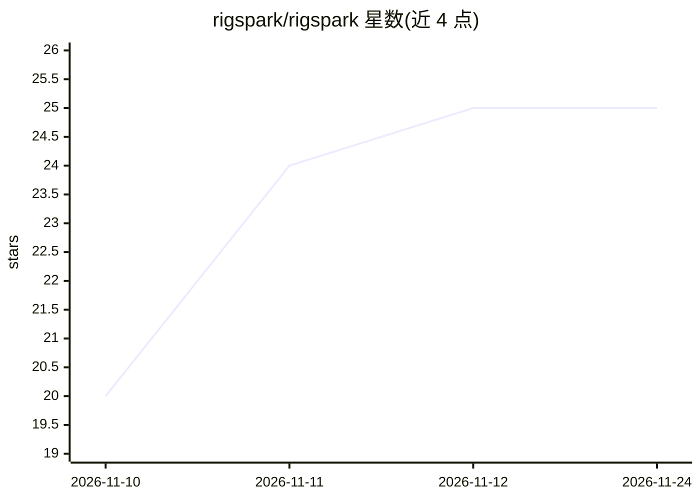

# rigspark/rigspark

⭐ 25 · Rust · MIT · 推送 2026-11-16 · [GitHub](https://github.com/rigspark/rigspark) · [官网](https://www.rigspark.ai/) · 个人维护

**本地运行开源模型的桌面应用：聊天/图像/视频/语音与硬件适配检查**

面向个人用户的本地 AI 桌面应用：在用户电脑上离线运行 Llama、Qwen、Gemma、DeepSeek 等开源模型进行聊天、生成图像与短视频、语音朗读与听写。核心机制是下载前按 RAM 和 GPU 给每个模型 yes/slow/no 适配判定，可粘贴 Hugging Face 仓库自动选取适配版本；模型经 SHA-256 校验后运行，通过 Ollama、llama.cpp、MLX、LM Studio 或 BitNet 执行。提供 macOS/Windows 桌面安装包，Linux 为浏览器界面加命令行；macOS 需 12 以上，Windows 安装包尚未代码签名。

## 筛选速览

| 维度 | 判定 | 备注 |
|---|---|---|
| AI 角色 | `ai-native` | 本体是模型或模型工具 |
| 许可风险 | `permissive` | MIT |
| 部署形态 | `desktop` | 安装包/桌面程序 |
| 模型依赖 | local-ok | 支持本地模型 |
| 硬件要求 | `cpu-ok` | |
| 安装摩擦 | `low` | 无编译、无系统依赖或容器化 |
| 成熟度 | `idea` | |

## 能力要点

- 下载前按 RAM/GPU 给出 yes/slow/no 模型适配判定与内存需求
- 支持聊天、图像、短视频、语音朗读与听写，聊天可完全离线
- 粘贴 Hugging Face 仓库自动比对各版本并选取可运行的最大版本
- 模型文件经固定 SHA-256 校验，服务器仅监听 127.0.0.1

## 适用场景

- 在自己电脑上离线运行开源模型聊天、生成图片和短视频
- 下载前确认某个模型在我的内存和显卡上能否运行
- 把本地模型接入 Claude Code、Codex 等编码工具

## 场景标签

`AI 助手` `图像生成` `视频生成` · 领域:对话与助手

## 证据(README 行号)

> L3:  Run AI on your own computer: chat, make images and video, and talk to it.
> L19: - **Know before you download.** Every model gets a **yes / slow / no** verdict for

## 星数曲线

2026-11-10 20 → 2026-11-24 25（+5）

---
*卡片 v1 · prompt 1.4 · 生成 2026-11-18 · 置信度 high · 依据 README sha `a59b30633275` · [字段定义](../../DATASET.md)*
