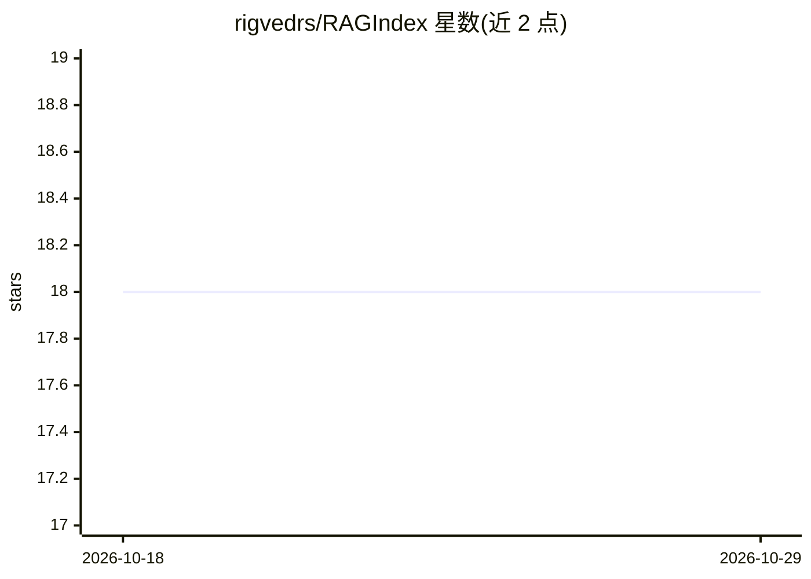

# rigvedrs/RAGIndex

⭐ 18 · Python · 推送 2025-12-07 · [GitHub](https://github.com/rigvedrs/RAGIndex) · 个人维护

**基于 LlamaIndex 的文档问答应用：PDF/DOCX/TXT 上传即问即答**

面向终端用户的 RAG 文档问答 Web 应用：用户通过 Streamlit 界面上传 PDF、DOCX 或 TXT，系统用 LlamaIndex 做语义分块与索引，向量存于 Redis，回答时附带文档与页码级引用。OCR 管线在文本抽取失败时自动回退到 Tesseract 处理图像型 PDF；文档存储支持去重与缓存。需配置 OpenAI API key，通过 Docker Compose 一键部署，嵌入模型默认 bge-base-en-v1.5。

## 筛选速览

| 维度 | 判定 | 备注 |
|---|---|---|
| AI 角色 | `ai-native` | 本体是模型或模型工具 |
| 许可风险 | `none` | — |
| 部署形态 | `self-host` | docker 或自建部署 |
| 模型依赖 | — | README 未给出锁定关系 |
| 硬件要求 | — | 无带数字的原话,不猜 |
| 安装摩擦 | `low` | 无编译、无系统依赖或容器化 |
| 成熟度 | — | 结构信号不足 |

## 能力要点

- 页码级来源引用（PAGE_NUM 注入与元数据保留）
- 图像型 PDF 自动回退 Tesseract OCR 处理
- Redis 向量库 + 文档去重与摄取状态管理
- Docker Compose 容器化部署，支持多实例扩展

## 适用场景

- 把本地 PDF/DOCX/TXT 文档变成可问答的知识库
- 核验回答来源时直接定位到具体页码
- 处理扫描版图像 PDF 并纳入问答范围

## 场景标签

`文档问答` · 领域:知识与检索

## 证据(README 行号)

> L15: RAGIndex is a **Retrieval-Augmented Generation (RAG)** application that leverages **LlamaIndex** for document proce
> L60: Create a `.env` file with your OpenAI API key:

## 星数曲线

2026-10-18 18 → 2026-10-29 18（+0）

---
*卡片 v1 · prompt 1.4 · 生成 2026-10-29 · 置信度 mid · 依据 README sha `c58ff51ec7a0` · [字段定义](../../DATASET.md)*
