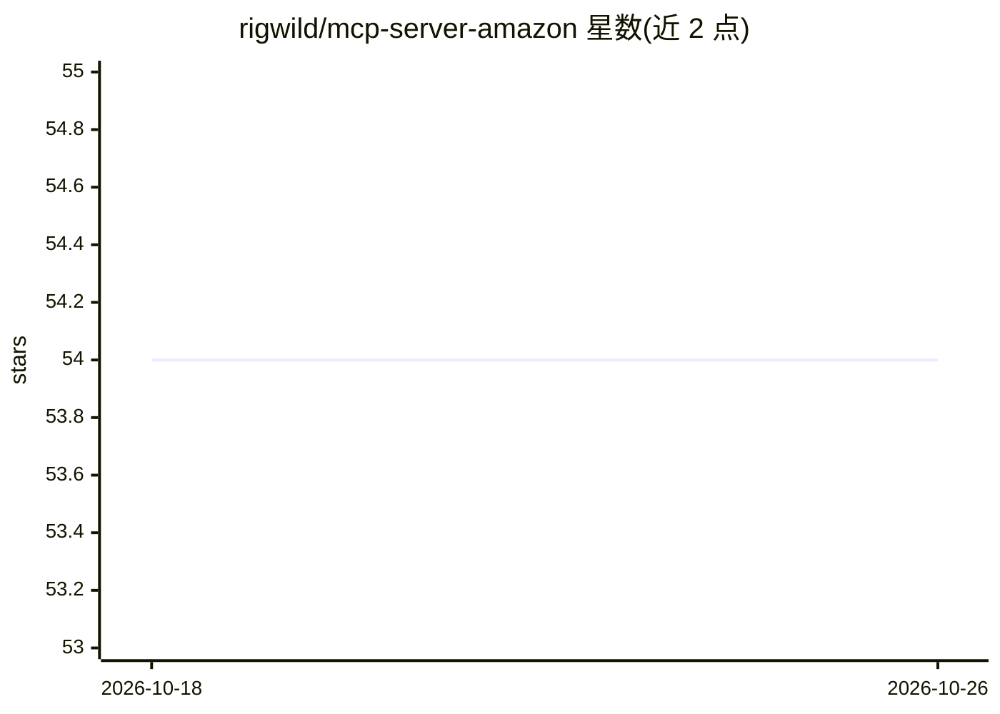

# rigwild/mcp-server-amazon

⭐ 54 · TypeScript · MIT · 推送 2026-07-25 · [GitHub](https://github.com/rigwild/mcp-server-amazon) · 个人维护

**非官方 Amazon MCP 服务器：在 Claude 中搜索购买商品**

基于 Model Context Protocol 的非官方 Amazon 服务接口服务器，向 ChatGPT 或 Claude 等对话界面暴露商品搜索、商品详情、购物车管理、下单（演示用途的模拟下单）与历史订单查询五类工具，让用户在对话中操作自己的 Amazon 账户。以 npm 安装依赖并 npm run build 构建后，通过 Claude Desktop 的 claude_desktop_config.json 注册运行，日志输出至本地文件。MIT 许可。

## 筛选速览

| 维度 | 判定 | 备注 |
|---|---|---|
| AI 角色 | `ai-ecosystem` | LLM/agent 周边工具 |
| 许可风险 | `permissive` | MIT |
| 部署形态 | `library` | 以包/库形式分发 |
| 模型依赖 | locked-api |  |
| 硬件要求 | — | 无带数字的原话,不猜 |
| 安装摩擦 | `low` | 无编译、无系统依赖或容器化 |
| 成熟度 | — | 结构信号不足 |

## 能力要点

- 提供商品搜索/详情/购物车/下单/订单历史五类 MCP 工具
- 通过 Claude Desktop 配置文件集成为 MCP 服务器
- 下单功能为演示用途的模拟下单

## 适用场景

- 在 Claude 对话中搜索并比较 Amazon 商品
- 让 AI 助手管理 Amazon 购物车与查看订单历史
- 体验 MCP 协议接入电商账户的示例

## 场景标签

 · 领域:电商/AI 工具集成

## 证据(README 行号)

> L3: This server allows you to interact with Amazon's services using the MCP (Model Context Protocol) framework. This let
> L41: ## Claude Desktop Integration

## 星数曲线

2026-10-18 54 → 2026-10-26 54（+0）

---
*卡片 v1 · prompt 1.4 · 生成 2026-10-24 · 置信度 high · 依据 README sha `257c0c14e79c` · [字段定义](../../DATASET.md)*
