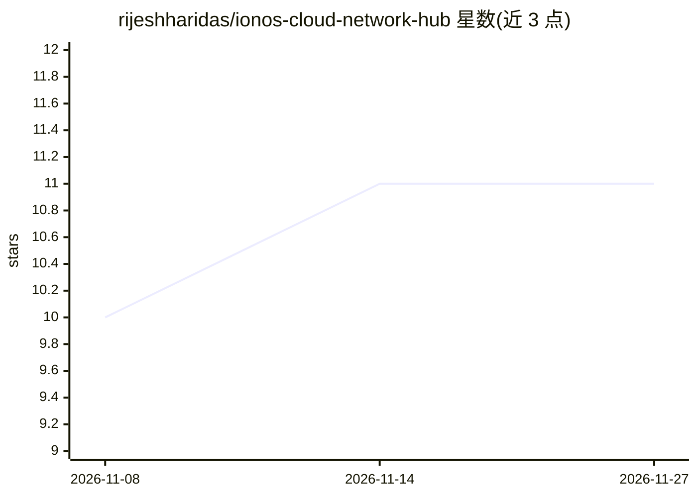

# rijeshharidas/ionos-cloud-network-hub

⭐ 11 · HTML · NOASSERTION · 推送 2026-03-16 · [GitHub](https://github.com/rijeshharidas/ionos-cloud-network-hub) · [官网](https://cloud.ionos.com/) · 个人维护

**给 IONOS Cloud 用户提供基础设施可视化与 AI 助手的本地网页工具**

以单文件 HTML + 本地 Python CORS 代理（仅标准库）形式运行，通过浏览器读取 IONOS Cloud API，将用户的 VDC、服务器、LAN、数据库、DNS、负载均衡等资源渲染为全球地图与拓扑图，并提供流量热图、空闲 VM 扫描、计费数据等分析视图。内置 AI Cloud Assistant 接入 IONOS AI Model Hub，可选 Llama 3.3 70B 等模型，支持基础设施问答、自然语言生成拓扑草稿、导出 Terraform 与 12 规则合规审计。需 IONOS API token，token 不离开本机。

## 筛选速览

| 维度 | 判定 | 备注 |
|---|---|---|
| AI 角色 | `ai-enhanced` | 去掉 AI 部分产品仍成立 |
| 许可风险 | `permissive` | NOASSERTION |
| 部署形态 | `desktop` | 安装包/桌面程序 |
| 模型依赖 | — | README 未给出锁定关系 |
| 硬件要求 | — | 无带数字的原话,不猜 |
| 安装摩擦 | `low` | 无编译、无系统依赖或容器化 |
| 成熟度 | — | 结构信号不足 |

## 能力要点

- D3.js 拓扑 + Leaflet 地图，从全球区域到单台服务器的下钻视图
- AI 助手理解完整拓扑上下文，支持问答、架构设计与 Terraform 导出
- 12 规则合规审计覆盖网络、访问、审计、成本、数据五类
- 零构建步骤：无 npm、无 pip 依赖，Python 标准库或 Docker 运行

## 适用场景

- 在地图与拓扑图上巡视多区域 IONOS 云基础设施
- 让 AI 分析安全态势、成本优化与流量模式
- 拖入 flow log 文件分析流量并回溯到拓扑节点
- 用自然语言设计新架构并导出 Terraform

## 场景标签

`AI 助手` `代码生成` · 领域:编码与开发

## 证据(README 行号)

> L10:  Visualize, analyze, and get AI-powered insights for your IONOS Cloud infrastructure.
> L32: ## AI Cloud Assistant
> L36: The built-in AI Cloud Assistant connects to the **IONOS AI Model Hub** and understands your full cloud context — to

## 星数曲线

2026-11-08 10 → 2026-11-27 11（+1）

---
*卡片 v1 · prompt 1.4 · 生成 2026-11-18 · 置信度 mid · 依据 README sha `a415ee9df5eb` · [字段定义](../../DATASET.md)*
