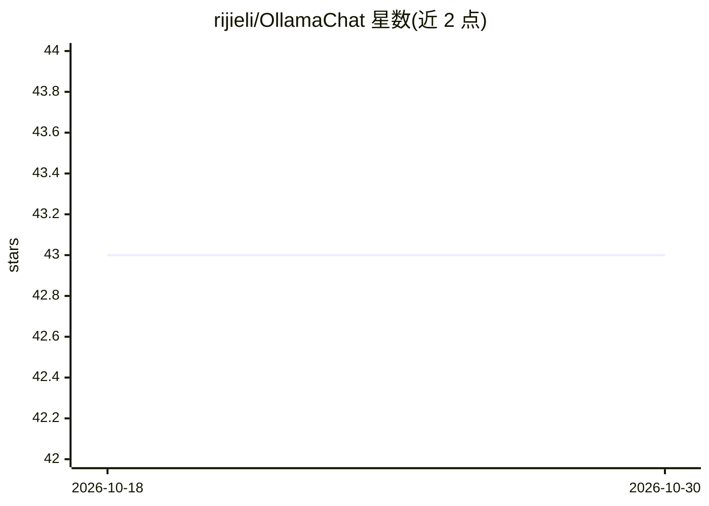

# rijieli/OllamaChat

⭐ 43 · Swift · MIT · 推送 2026-03-10 · [GitHub](https://github.com/rijieli/OllamaChat) · 个人维护

**macOS 上 Ollama 的 SwiftUI 图形聊天客户端**

基于 SwiftUI 开发的 macOS 桌面应用，为本地运行时 Ollama 提供图形聊天界面，是 kghandour Ollama-SwiftUI 的 fork，增加了消息重试与编辑、cmd+enter 发送、系统提示词、聊天历史访问等功能，兼容 macOS 13。依赖本机已安装并在后台运行的 Ollama 才能工作；可在设置中修改目标 IP 和端口以连接 Ollama 服务。提供下载版应用，也可用 Xcode 从源码构建。

## 筛选速览

| 维度 | 判定 | 备注 |
|---|---|---|
| AI 角色 | `ai-ecosystem` | LLM/agent 周边工具 |
| 许可风险 | `permissive` | MIT |
| 部署形态 | `None` |  |
| 模型依赖 | local-ok | 支持本地模型 |
| 硬件要求 | — | 无带数字的原话,不猜 |
| 安装摩擦 | `low` | 无编译、无系统依赖或容器化 |
| 成熟度 | — | 结构信号不足 |

## 能力要点

- 为 Ollama 提供 SwiftUI 图形聊天界面
- 支持消息重试/编辑、系统提示词、聊天历史
- 可配置 Ollama 服务的 IP 与端口
- 兼容 macOS 13，可作为 Xcode 工程从源码构建

## 适用场景

- 在 macOS 上通过图形界面与本地 Ollama 模型对话
- 在应用内管理和下载 Ollama 模型
- 连接自定义地址上运行的 Ollama 服务

## 场景标签

`聊天机器人` · 领域:对话与助手

## 证据(README 行号)

> L4: A user-friendly interface for Ollama created in SwiftUI.
> L14: **This app requires Ollama to be installed and running to function.**

## 星数曲线

2026-10-18 43 → 2026-10-30 43（+0）

---
*卡片 v1 · prompt 1.4 · 生成 2026-10-25 · 置信度 high · 依据 README sha `8944f157a636` · [字段定义](../../DATASET.md)*
