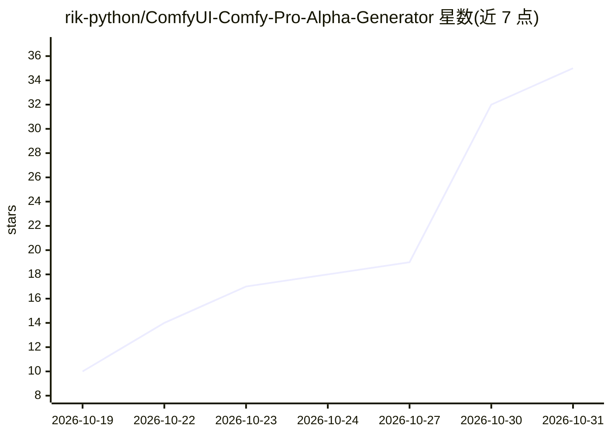

# rik-python/ComfyUI-Comfy-Pro-Alpha-Generator

⭐ 35 · Python · GPL-3.0 · 推送 2026-10-27 · [GitHub](https://github.com/rik-python/ComfyUI-Comfy-Pro-Alpha-Generator) · [官网](https://www.comfycompositing.com) · 个人维护

**ComfyUI 抠像节点：点选人物，SAM3+LTX 生成发丝级 alpha**

面向 VFX 合成的单节点 ComfyUI 自定义节点：用户在画面上点选或文字指定单一主体，SAM3 追踪选定对象并将其余人物从副本中 inpaint 移除，LTX-2.5 alpha-gen 为选定主体绘制发丝级边缘，输出 16-bit alpha、premultiplied comp 与 EXR；支持原生 4K 分块、人物交叠模式与边缘颜色重建。限制：LTX 需从 Hugging Face 接受 Lightricks 双许可下载模型，运行需 12 GB VRAM，长镜头 RAM 需求随帧数增长（247 帧约 73-97 GB）。安装经 ComfyUI Manager 以 Git URL 方式完成。

## 筛选速览

| 维度 | 判定 | 备注 |
|---|---|---|
| AI 角色 | `ai-native` | 本体是模型或模型工具 |
| 许可风险 | `viral` | GPL-3.0 |
| 部署形态 | `library` | 以包/库形式分发 |
| 模型依赖 | — | README 未给出锁定关系 |
| 硬件要求 | `gpu-8g` | |
| 安装摩擦 | `low` | 无编译、无系统依赖或容器化 |
| 成熟度 | — | 结构信号不足 |

## 能力要点

- 点选/文字指定单一主体，SAM3 追踪 + LTX-2.5 绘制发丝级边缘
- 原生 4K 分块处理（UHD/DCI 4K、2K），EXR 输入输出
- 边缘颜色重建，输出干净 premultiplied comp（rgba_ 文件）
- QC 指标（边缘细节匹配率等）每次运行后在节点上显示

## 适用场景

- 从多人画面中只抠出指定的一人并保留发丝细节
- 4K 镜头直接生成原生分辨率 alpha 而非 1080p 放大
- 合成时去除发丝边缘残留的原背景色（天空/草地）

## 场景标签

`图像视频处理` · 领域:感知与多模态

## 证据(README 行号)

> L20: **One ComfyUI node that mattes one chosen person with generative-quality edges.** Click the subject on the plate:
> L21: SAM3 tracks it, LTX-2.5 alpha-gen draws the hair, and you get a 16-bit alpha plus a clean premultiplied comp.

## 星数曲线

2026-10-19 10 → 2026-10-31 35（+25）

---
*卡片 v1 · prompt 1.4 · 生成 2026-10-28 · 置信度 mid · 依据 README sha `86f59ac6f503` · [字段定义](../../DATASET.md)*
