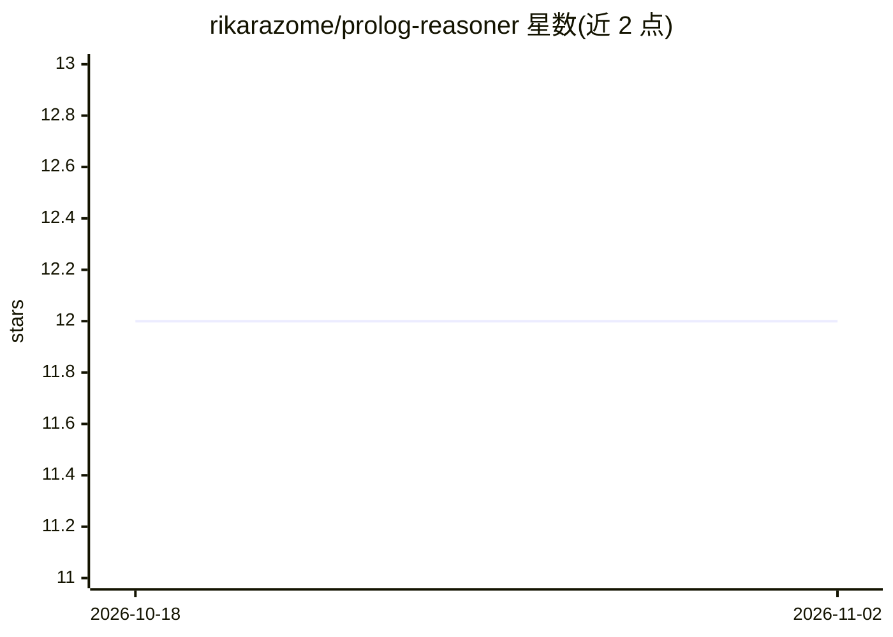

# rikarazome/prolog-reasoner

⭐ 12 · Python · MIT · 推送 2026-05-01 · [GitHub](https://github.com/rikarazome/prolog-reasoner) · [官网](https://pypi.org/project/prolog-reasoner/) · 个人维护

**给 LLM 用的 SWI-Prolog 逻辑计算器：MCP 服务器 + Python 库**

把 SWI-Prolog 执行暴露给 LLM 的工具：MCP 服务器提供 execute_prolog 及四个命名规则库管理工具（保存/列出/读取/删除可复用 Prolog 规则），服务器本身不调用外部 LLM API；Python 库模式提供自然语言→Prolog 的翻译流水线与自纠错循环，需 OpenAI 或 Anthropic API key。支持 CLP(FD) 约束逻辑编程、结构化证明树（可选）、自然语言错误提示。执行无状态，输入相同则输出相同。内置 30 题逻辑基准，自测 LLM+Prolog 达 27/30（LLM-only 22/30）。运行需本机安装 SWI-Prolog ≥9.0（或用 Docker 镜像自带）。

## 筛选速览

| 维度 | 判定 | 备注 |
|---|---|---|
| AI 角色 | `ai-ecosystem` | LLM/agent 周边工具 |
| 许可风险 | `permissive` | MIT |
| 部署形态 | `self-host` | docker 或自建部署 |
| 模型依赖 | locked-api |  |
| 硬件要求 | — | 无带数字的原话,不猜 |
| 安装摩擦 | `low` | 无编译、无系统依赖或容器化 |
| 成熟度 | — | 结构信号不足 |

## 能力要点

- MCP 服务器提供 execute_prolog 与四个命名规则库管理工具，无需 API key
- Python 库模式提供 NL→Prolog 翻译流水线与自纠错（OpenAI/Anthropic）
- 支持 CLP(FD)、可选证明树 trace、分类错误码与自然语言错误提示
- 无状态执行：相同输入（含相同规则库）总是相同输出

## 适用场景

- 让 Claude 等 MCP 客户端在对话中调用 Prolog 求解约束满足或多步推理问题
- 把稳定的领域规则（棋类走法、法律公理）存成命名规则库反复复用
- 以 Python 库形式搭建自然语言到 Prolog 的推理流水线并查看可审计的中间代码

## 场景标签

 · 领域:LLM 基础设施/符号推理工具

## 证据(README 行号)

> L8: SWI-Prolog as a "logic calculator" for LLMs — available as an MCP server and a Python library. Eliminate the black b
> L32: - **MCP server** — Claude (or any MCP client) calls it as a logic solver during conversation. **Rule bases** let th
> L141: The library exposes `PrologExecutor` (Prolog-only, no LLM) and `PrologReasoner` (NL→Prolog pipeline, needs an LLM 

## 星数曲线

2026-10-18 12 → 2026-11-02 12（+0）

---
*卡片 v1 · prompt 1.4 · 生成 2026-11-01 · 置信度 high · 依据 README sha `09a3c0753241` · [字段定义](../../DATASET.md)*
