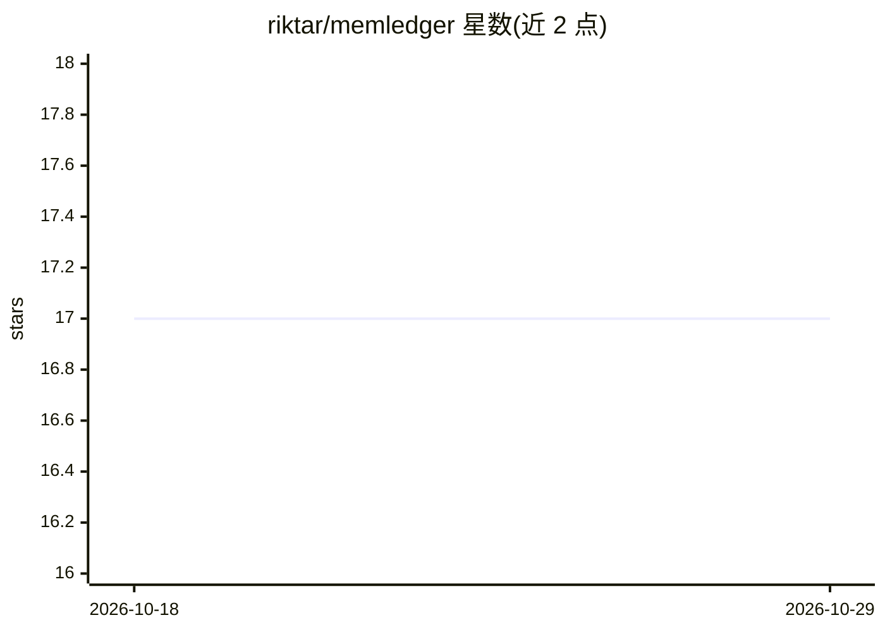

# riktar/memledger

⭐ 17 · Python · MIT · 推送 2026-07-14 · [GitHub](https://github.com/riktar/memledger) · 个人维护

**带完整溯源链的 AI agent 记忆系统：能回答'为什么记住'**

面向 AI agent 开发者的记忆框架，核心是 append-only 事件账本：每条记忆（抽取、晋升、合并、删除）都记录来源句子、所用模型与审批人，可通过 memledger why/replay/regenerate 查询、重放与重建。三层记忆（Instinct/Episodic/Working）建立在账本之上；确定性过滤器先筛掉不值得 LLM 抽取的对话轮次以降低成本；新事实需跨会话确认并经 review 审批，支持级联删除。存储为单个 SQLite 文件，可选本地 Ollama 模型或云端端点，MIT 许可。当前为 0.1 版本，单 agent、单文件、单写入者。

## 筛选速览

| 维度 | 判定 | 备注 |
|---|---|---|
| AI 角色 | `ai-ecosystem` | LLM/agent 周边工具 |
| 许可风险 | `permissive` | MIT |
| 部署形态 | `library` | 以包/库形式分发 |
| 模型依赖 | local-ok | 支持本地模型 |
| 硬件要求 | — | 无带数字的原话,不猜 |
| 安装摩擦 | `low` | 无编译、无系统依赖或容器化 |
| 成熟度 | `idea` | |

## 能力要点

- 每条记忆的完整溯源链：来源句子、抽取模型、晋升原因、审批人
- 确定性预过滤跳过寒暄类对话，降低 LLM 抽取成本
- 保留原始对话，可 regenerate 用新模型重建全部记忆
- 新事实隔离至跨会话确认并经 memledger review 审批

## 适用场景

- 调试 agent 记忆：查某条偏好的来源与被保留/删除的原因
- 防止记忆投毒：对未确认事实隔离并人工审批
- 换更强模型后从原始历史重建 agent 记忆

## 场景标签

`Agent 记忆` · 领域:Agent 开发

## 证据(README 行号)

> L19: **MemLedger is memory with the black box wide open.** Every fact your agent
> L66: Three memory layers mimicking human cognition, all built on an append-only
> L82: Every extraction, promotion, merge, and deletion is an event with an

## 星数曲线

2026-10-18 17 → 2026-10-29 17（+0）

---
*卡片 v1 · prompt 1.4 · 生成 2026-10-29 · 置信度 high · 依据 README sha `501046016285` · [字段定义](../../DATASET.md)*
