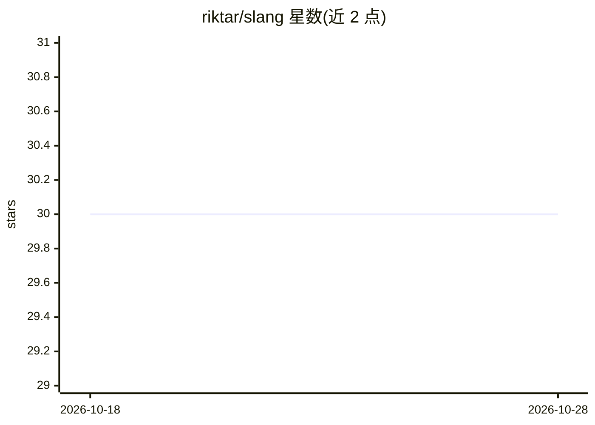

# riktar/slang

⭐ 30 · TypeScript · MIT · 推送 2026-07-01 · [GitHub](https://github.com/riktar/slang) · [官网](https://riktar.github.io/slang/) · 个人维护

**声明式多 agent 工作流元语言，可读可执行、跨模型可移植**

SLANG（Super Language for Agent Negotiation & Governance）是一种以 .slang 文件描述多 agent 工作流的声明式元语言，含 stake/await/commit 三个原语及条件、变量、循环等控制流。提供两种运行方式：零安装模式（把系统提示与 .slang 流程粘贴进任意 LLM 对话）与 CLI/API/MCP 模式（npm 安装，经 OpenRouter 支持 300+ 模型，含 checkpoint 恢复、死锁检测、结构化输出、LSP 与 Web playground）。面向 PM、分析师与开发者共同读写同一工作流文件。

## 筛选速览

| 维度 | 判定 | 备注 |
|---|---|---|
| AI 角色 | `ai-ecosystem` | LLM/agent 周边工具 |
| 许可风险 | `permissive` | MIT |
| 部署形态 | `library` | 以包/库形式分发 |
| 模型依赖 | locked-api |  |
| 硬件要求 | — | 无带数字的原话,不猜 |
| 安装摩擦 | `low` | 无编译、无系统依赖或容器化 |
| 成熟度 | — | 结构信号不足 |

## 能力要点

- stake/await/commit 三原语描述多 agent 协作
- 同一 .slang 文件可在 LLM 对话中零安装运行或经 CLI/API 生产运行
- 经 OpenRouter 接入 300+ 模型，支持多供应商路由
- 提供 LSP 语言服务器、Web playground、checkpoint 恢复与死锁检测

## 适用场景

- 用可读的声明式文件定义多 agent 工作流，让非开发者也能审查修改
- 把工作流粘贴进 ChatGPT/Claude/Gemini 快速原型验证
- 通过 CLI 在生产环境运行带真实工具与多模型路由的 agent 流程
- 以 MCP 集成到 Claude Desktop 等客户端

## 场景标签

`多智能体` `Agent 框架` · 领域:Agent 开发

## 证据(README 行号)

> L28: That's it. Three primitives. Your PM can read it. Your analyst can edit it. Your LLM can run it. No Python, no Type
> L210: Source → Lexer → Parser → AST → Resolver → Graph → Runtime → Result

## 星数曲线

2026-10-18 30 → 2026-10-28 30（+0）

---
*卡片 v1 · prompt 1.4 · 生成 2026-10-26 · 置信度 high · 依据 README sha `ea1dafef2f5e` · [字段定义](../../DATASET.md)*
