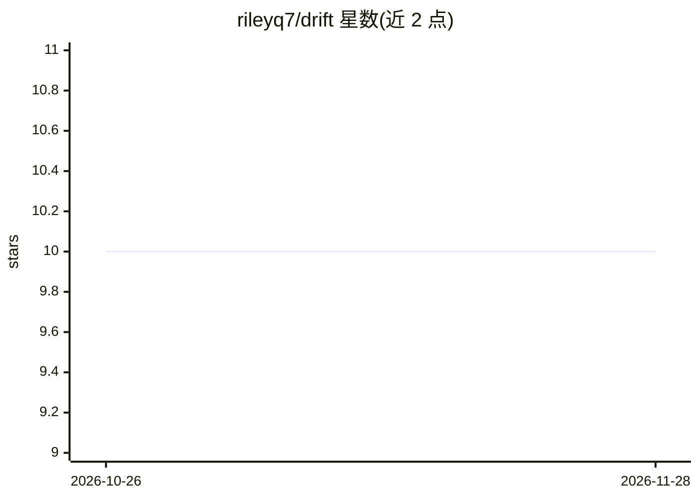

# rileyq7/drift

⭐ 10 · Python · MIT · 推送 2026-08-23 · [GitHub](https://github.com/rileyq7/drift) · [官网](https://dendric.io) · 个人维护

**用英文块编写 agent 并转译为异步 Python 的意图式语言**

Drift 是一种面向 agentic 系统的意图式 DSL：以英文风格的块编写 agent（含 model、budget、step、memory、pipeline 等），经转译器生成运行在自带轻量运行时上的异步 Python。提供 CLI（new/run/check）、MCP 工具声明、Dendric 记忆后端、跨 agent 调用与 confident 置信度门控分支。当前为 Alpha 阶段：OpenAI 与 Anthropic 双 provider 已实现，部分语法（如 ~>、|>、stream）虽可解析但尚未实现，为编译错误。

## 筛选速览

| 维度 | 判定 | 备注 |
|---|---|---|
| AI 角色 | `ai-ecosystem` | LLM/agent 周边工具 |
| 许可风险 | `permissive` | MIT |
| 部署形态 | `library` | 以包/库形式分发 |
| 模型依赖 | locked-api |  |
| 硬件要求 | — | 无带数字的原话,不猜 |
| 安装摩擦 | `low` | 无编译、无系统依赖或容器化 |
| 成熟度 | `idea` | |

## 能力要点

- intent 动词（summarize/extract/classify 等）各生成一次带类型的 LLM 调用
- confident<T> 置信度门控与 model 多 provider 路由（prefer/fallback/upgrade）
- pipeline 支持 -> 顺序与 => 并行 fan-out（asyncio.gather）
- pip install drift-lang 安装，含 mcp/dendric 可选扩展

## 适用场景

- 用英文块定义并运行结构化 agent（如邮件分类、分诊）
- 以 MCP 或 Python 函数声明外部工具接入 agent
- 在置信度不足时回退或切换更强模型路径

## 场景标签

`Agent 框架` · 领域:Agent 开发

## 证据(README 行号)

> L9: **An intent-based language for agentic systems.** Write your agent in English-shaped blocks, run it as async Python.
> L91: Alpha. Language surface is stable, runtime works, 573/573 tests passing. OpenAI + Anthropic providers, MCP tools, D

## 星数曲线

2026-10-26 10 → 2026-11-28 10（+0）

---
*卡片 v1 · prompt 1.4 · 生成 2026-11-19 · 置信度 high · 依据 README sha `4dc191dea839` · [字段定义](../../DATASET.md)*
