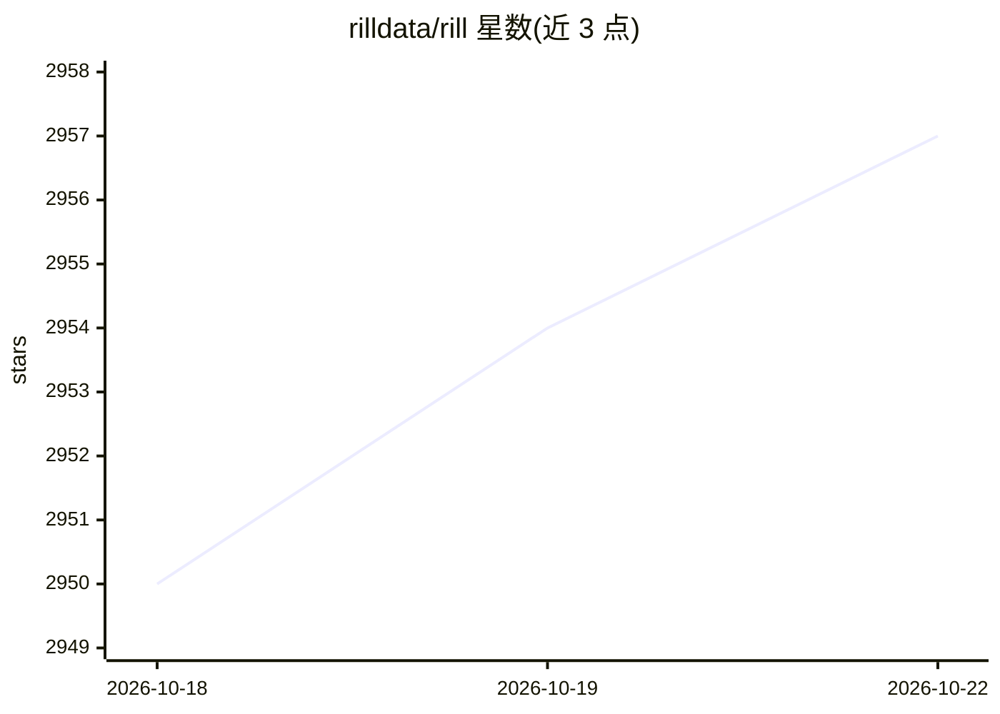

# rilldata/rill

⭐ 2,957 · Go · Apache-2.0 · 推送 2026-10-21 · [GitHub](https://github.com/rilldata/rill) · [官网](https://www.rilldata.com) · 组织维护

**面向人与 AI agent 的 BI 工具：以代码定义数据模型、指标与看板**

Rill 是一个以 BI-as-code（YAML + SQL）方式工作的商业智能工具，支持 S3、GCS 等 20+ 数据源，可选 DuckDB 或 ClickHouse 作为 OLAP 引擎，在查询时由语义层生成 SQL。本地以 Rill Developer 运行项目，通过 rill deploy 推送到 Rill Cloud 部署。AI 相关能力包括：供编码 agent（Claude Code、Cursor）端到端编写项目的代码化格式、自然语言查询指标的 Conversational BI，以及将 AI agent 接入指标语义层的 MCP Server。看板与指标可通过 REST API 或嵌入式看板对外输出。

## 筛选速览

| 维度 | 判定 | 备注 |
|---|---|---|
| AI 角色 | `ai-enhanced` | 去掉 AI 部分产品仍成立 |
| 许可风险 | `permissive` | Apache-2.0 |
| 部署形态 | `None` |  |
| 模型依赖 | — | README 未给出锁定关系 |
| 硬件要求 | — | 无带数字的原话,不猜 |
| 安装摩擦 | `low` | 无编译、无系统依赖或容器化 |
| 成熟度 | — | 结构信号不足 |

## 能力要点

- YAML + SQL 的 BI-as-code 项目结构，可由编码 agent 编写
- 语义层在查询时对 DuckDB/ClickHouse 生成 SQL
- MCP Server 将 Claude、ChatGPT 等 agent 接入指标层
- 行级访问策略与可嵌入看板、自定义 API

## 适用场景

- 用 YAML/SQL 定义指标与看板并部署到云端
- 让业务用户以自然语言查询指标
- 把看板或指标 API 嵌入到自己的产品中
- 让 AI agent 通过 MCP 直接查询语义层

## 场景标签

`数据分析` · 领域:效率与自动化

## 证据(README 行号)

> L30: **Rill** is the fastest BI tool for humans and agents, powered by OLAP engines like ClickHouse and DuckDB.
> L52: - **Build with agents** — BI-as-code (YAML + SQL) means coding agents like Claude Code and Cursor can author projec
> L54: - **Explore with agents** — Conversational BI lets business users query metrics in natural language; the MCP server
> L76: - **MCP Server** — Connect Claude, ChatGPT, or any AI agent to your metrics

## 星数曲线

2026-10-18 2,950 → 2026-10-22 2,957（+7）

---
*卡片 v1 · prompt 1.4 · 生成 2026-10-21 · 置信度 high · 依据 README sha `6edb320724e3` · [字段定义](../../DATASET.md)*
