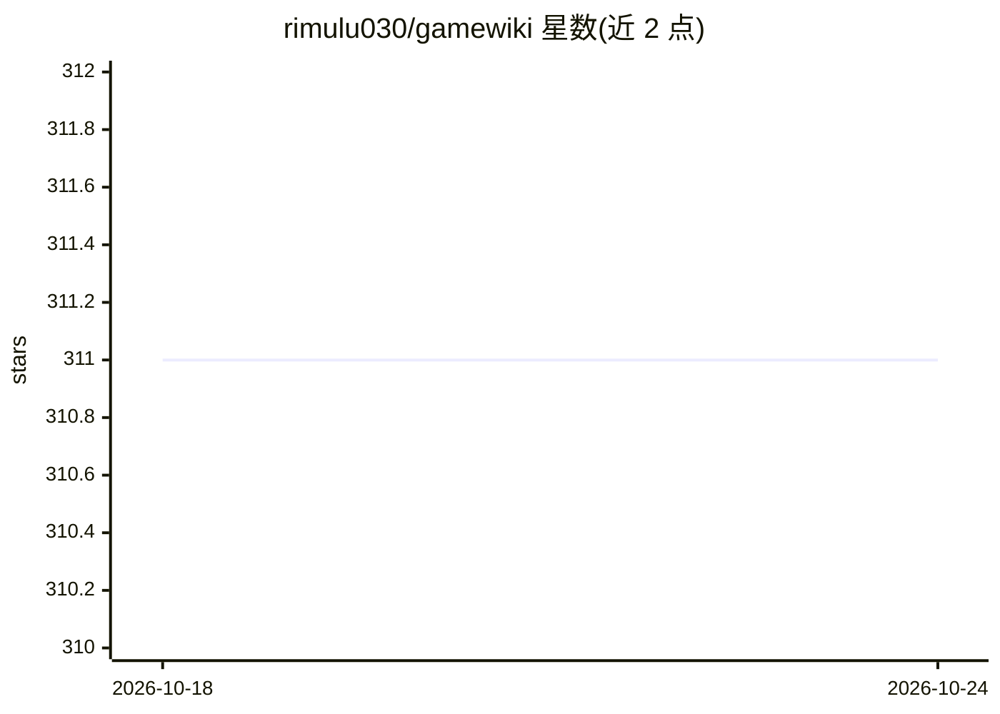

# rimulu030/gamewiki

⭐ 311 · Python · GPL-3.0 · 推送 2026-03-03 · [GitHub](https://github.com/rimulu030/gamewiki) · [官网](https://www.gamewiki.app) · 个人维护 · 中文 README

**游戏内 Wiki 覆盖层工具：热键呼出 Wiki 与 Gemini 问答**

面向玩家的 Windows 桌面覆盖层工具：游戏运行中按热键（默认 Ctrl+Q）呼出窗口，提供 100+ 游戏的 Wiki 快速访问、网页浏览功能，以及基于 Google Gemini API 与本地知识库的 AI 问答（4 款游戏有完整知识库）。自动检测前台游戏，支持 EN/ZH 语言与语音识别设置。AI 功能需自备 Google 账号并从 Google AI Studio 获取 Gemini API key；提供便携版可执行文件或从 Python 源码运行，GPL3.0 许可。

## 筛选速览

| 维度 | 判定 | 备注 |
|---|---|---|
| AI 角色 | `ai-enhanced` | 去掉 AI 部分产品仍成立 |
| 许可风险 | `viral` | GPL-3.0 |
| 部署形态 | `desktop` | 安装包/桌面程序 |
| 模型依赖 | — | README 未给出锁定关系 |
| 硬件要求 | — | 无带数字的原话,不猜 |
| 安装摩擦 | `low` | 无编译、无系统依赖或容器化 |
| 成熟度 | — | 结构信号不足 |

## 能力要点

- 热键（默认 Ctrl+Q）游戏内呼出 Wiki/AI 聊天覆盖层，无需切出游戏
- 基于 Gemini API 与本地知识库的 AI 问答，4 款游戏含完整知识库
- 100+ 游戏的 Wiki 快速访问，另可作网页浏览器使用
- 自动游戏检测与自定义热键/语言/语音识别配置

## 适用场景

- 游戏卡关时不切出游戏，热键查 Wiki 或问 AI
- 为 Helldivers 2、艾尔登法环等游戏查装备/Boss/Build 信息
- 游戏内快速打开网页查资料

## 场景标签

`聊天机器人` · 领域:对话与助手

## 证据(README 行号)

> L19: - **🔥 One Hotkey, All Answers** - Press `Ctrl+Q` to instantly overlay wiki/AI chat without leaving your game
> L20: - **🤖 AI Game Expert** - Powered by Google Gemini with local knowledge bases for smart Q&A.
> L32: - Quick access to Wikis

## 星数曲线

2026-10-18 311 → 2026-10-24 311（+0）

---
*卡片 v1 · prompt 1.4 · 生成 2026-10-21 · 置信度 high · 依据 README sha `33e34af6a78a` · [字段定义](../../DATASET.md)*
