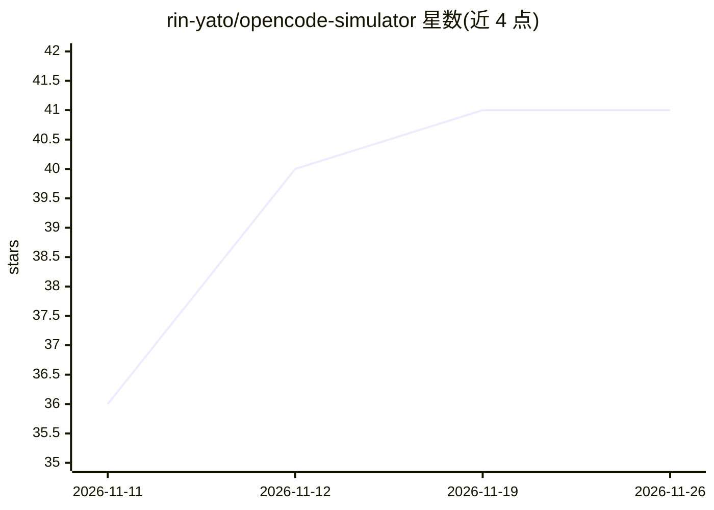

# rin-yato/opencode-simulator

⭐ 41 · TypeScript · MIT · 推送 2026-11-11 · [GitHub](https://github.com/rin-yato/opencode-simulator) · 个人维护

**在 OpenCode Desktop 内嵌入 iOS 模拟器并供 agent 驱动的插件**

面向 OpenCode Desktop 2.2+ 的插件：将 iOS Simulator 画面以 WebRTC H.264 流（HTTP 回退）嵌入侧边面板，用户可手动操作，agent 可通过 sim_* 系列工具驱动模拟器，覆盖设备生命周期、应用安装与启动、屏幕检查、输入手势、日志与崩溃报告、权限与深链等。每个会话拥有独立模拟器，插件维护自己的模拟器池（每机型/运行时最多 5 台），不自动触碰外部设备。流仅绑定 127.0.0.1，无遥测。要求 macOS、Xcode 与 iOS 运行时、Node 22+。

## 筛选速览

| 维度 | 判定 | 备注 |
|---|---|---|
| AI 角色 | `ai-ecosystem` | LLM/agent 周边工具 |
| 许可风险 | `permissive` | MIT |
| 部署形态 | `None` |  |
| 模型依赖 | — | README 未给出锁定关系 |
| 硬件要求 | — | 无带数字的原话,不猜 |
| 安装摩擦 | `low` | 无编译、无系统依赖或容器化 |
| 成熟度 | — | 结构信号不足 |

## 能力要点

- sim_* 工具集覆盖设备/应用生命周期、输入手势、屏幕检查与调试
- WebRTC H.264 流式面板，带 HTTP 回退
- 每会话独立模拟器，托管设备池自动复用与闲置关机
- 流仅绑定 127.0.0.1，无遥测

## 适用场景

- 让 agent 在 iOS 模拟器中安装、启动并操作应用做测试
- 在 OpenCode Desktop 内并排查看代码与实时模拟器画面
- 多个会话并行各用一台模拟器互不干扰

## 场景标签

`GUI 自动化` · 领域:效率与自动化

## 证据(README 行号)

> L2:  A live iOS Simulator inside OpenCode Desktop, with tools your agent can drive.
> L12: - **Agent tools.** Device lifecycle, apps, accessibility reads, input, settings, screenshots.

## 星数曲线

2026-11-11 36 → 2026-11-26 41（+5）

---
*卡片 v1 · prompt 1.4 · 生成 2026-11-18 · 置信度 high · 依据 README sha `fcff76f4ff20` · [字段定义](../../DATASET.md)*
