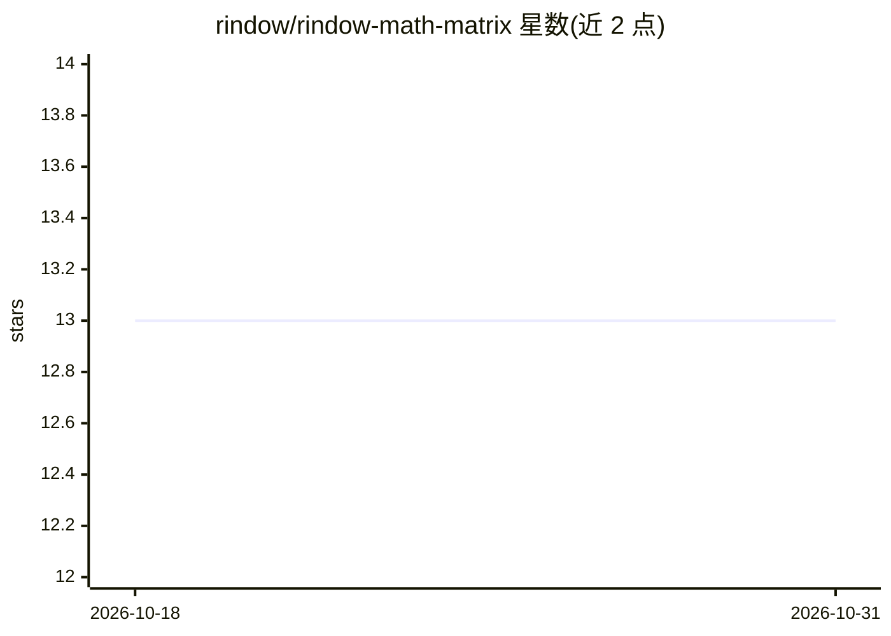

# rindow/rindow-math-matrix

⭐ 13 · PHP · BSD-3-Clause · 推送 2026-08-31 · [GitHub](https://github.com/rindow/rindow-math-matrix) · [官网](https://rindow.github.io/mathematics/) · 组织维护

**PHP 8 的 N 维数组与科学矩阵运算基础库**

面向 PHP 8.1+ 的科学矩阵运算库：提供 N 维数组对象、广播函数、BLAS 函数、线性代数与随机数能力，以及机器学习相关函数；通过 FFI 集成 C/C++ 库（OpenBLAS、Rindow-Matlib、CLBlast），并支持基于 OpenCL 的非 NVIDIA GPU 加速。单独使用可用，但达到实用速度需安装 matlibffi 插件与预编译二进制。以 composer 包形式安装，PHP 8.0 及以下需使用 Release 1.1。

## 筛选速览

| 维度 | 判定 | 备注 |
|---|---|---|
| AI 角色 | `ai-native` | 本体是模型或模型工具 |
| 许可风险 | `permissive` | BSD-3-Clause |
| 部署形态 | `None` |  |
| 模型依赖 | — | README 未给出锁定关系 |
| 硬件要求 | — | 无带数字的原话,不猜 |
| 安装摩擦 | `low` | 无编译、无系统依赖或容器化 |
| 成熟度 | — | 结构信号不足 |

## 能力要点

- N 维数组对象与广播函数、BLAS 函数
- FFI 集成 OpenBLAS/Rindow-Matlib/CLBlast 加速
- OpenCL 支持 Intel/AMD 等非 NVIDIA GPU
- 线性代数与随机数能力

## 适用场景

- 在 PHP 项目中做 N 维数组与矩阵科学运算
- 为 PHP 机器学习项目提供数值计算底座
- 在无 NVIDIA 显卡的笔记本上用 OpenCL 加速计算

## 场景标签

 · 领域:科学计算/数值库

## 证据(README 行号)

> L10: - A powerful N-dimensional array object
> L13: - Functions useful for machine learning

## 星数曲线

2026-10-18 13 → 2026-10-31 13（+0）

---
*卡片 v1 · prompt 1.4 · 生成 2026-10-31 · 置信度 high · 依据 README sha `322f3d0e3917` · [字段定义](../../DATASET.md)*
