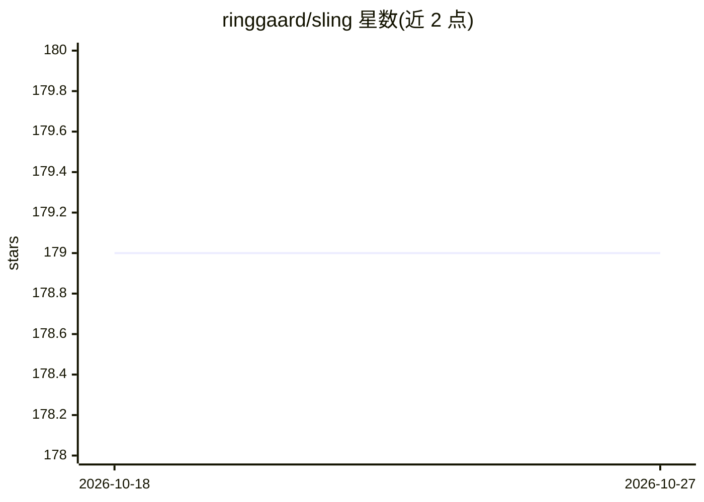

# ringgaard/sling

⭐ 179 · C++ · Apache-2.0 · 推送 2026-08-18 · [GitHub](https://github.com/ringgaard/sling) · 个人维护

**框架语义解析器：为文本生成框架语义标注以扩充知识库**

由 Ringgaard Research 开发的自然语言框架语义解析器，目标是阅读并理解多语言维基百科文章，将其中提及的事实加入 Wikidata 知识库。核心包括：基于双向 LSTM 与 TBRU 转移系统的联合训练解析器，可直接从文本 token 输出框架图；帧存储框架用于构建和操作框架语义图；Wiki flow 管线可将 Wikidata/Wikipedia 原始 dump 转换为帧图和带结构化标注的文档；另有神经网络 JIT 编译器与 Python API。README 声明项目仍在进行中，尚无完整系统。

## 筛选速览

| 维度 | 判定 | 备注 |
|---|---|---|
| AI 角色 | `ai-native` | 本体是模型或模型工具 |
| 许可风险 | `permissive` | Apache-2.0 |
| 部署形态 | `None` |  |
| 模型依赖 | — | README 未给出锁定关系 |
| 硬件要求 | — | 无带数字的原话,不猜 |
| 安装摩擦 | `low` | 无编译、无系统依赖或容器化 |
| 成熟度 | `idea` | |

## 能力要点

- 转移式框架语义解析器（BiLSTM 编码 + TBRU 解码，直接输出框架图）
- 帧存储框架支持内存图遍历做知识库推理
- Wiki flow 管线处理 Wikidata/Wikipedia 原始 dump
- 附带神经网络 JIT 编译器与 Python API

## 适用场景

- 为文本生成框架语义标注
- 从 Wikipedia 文本中抽取事实以补全 Wikidata 知识库
- 将 Wikidata dump 转为帧图做图遍历推理

## 场景标签

`知识图谱` · 领域:知识与检索

## 证据(README 行号)

> L9: both knowledge representation and document annotation. The SLING parser can
> L34: The SLING parser is used for annotating text with frame semantic annotations.

## 星数曲线

2026-10-18 179 → 2026-10-27 179（+0）

---
*卡片 v1 · prompt 1.4 · 生成 2026-10-22 · 置信度 high · 依据 README sha `994e624ef973` · [字段定义](../../DATASET.md)*
