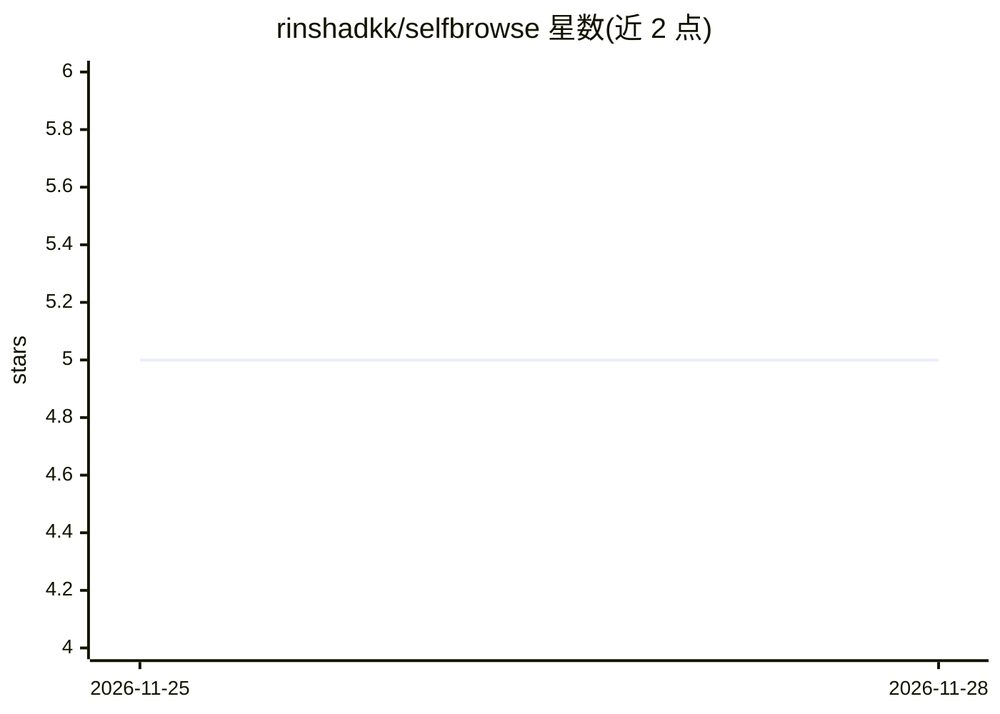

# rinshadkk/selfbrowse

⭐ 5 · Python · MIT · 推送 2026-11-27 · [GitHub](https://github.com/rinshadkk/selfbrowse) · [官网](https://selfbrowse.ai/) · 个人维护

**给开发者的低 token 浏览器 agent：以编号清单代替 DOM/截图**

开源 Python 浏览器 agent，以库、命令行工具和 MCP 服务器三种形式提供。核心机制是把页面转为简短的编号元素列表交给模型，不传 DOM 与截图，降低 token 消耗；内置 PII 占位符脱敏（密码/邮箱/卡号等，可选 Presidio）、域名白名单与风险确认等 guardrails、每步 tracing 与 OpenTelemetry 导出、以及按站点保存并回放已学习点击流（免模型调用）。出现 CAPTCHA/登录时暂停交人工完成。限制包括不支持闭合 shadow root 与 vision、学习仅对重复任务有效、AgentCore/Azure/Bedrock 路由仅用替身测试过。

## 筛选速览

| 维度 | 判定 | 备注 |
|---|---|---|
| AI 角色 | `ai-native` | 本体是模型或模型工具 |
| 许可风险 | `permissive` | MIT |
| 部署形态 | `library` | 以包/库形式分发 |
| 模型依赖 | local-ok | 支持本地模型 |
| 硬件要求 | — | 无带数字的原话,不猜 |
| 安装摩擦 | `low` | 无编译、无系统依赖或容器化 |
| 成熟度 | `idea` | |

## 能力要点

- 页面以编号列表传入模型，token 消耗低于传 DOM/截图
- PII 占位符脱敏，真实值仅在键盘输入时替换
- 已学习点击流回放，重复任务不消耗模型调用
- 可作为 MCP server 为 Claude/VS Code 提供浏览器工具

## 适用场景

- 用自然语言驱动真实浏览器完成搜索、比价等任务
- 在登录态网站上执行任务而不把密码暴露给模型
- 为 Claude 或 VS Code 等 MCP 客户端提供浏览器工具

## 场景标签

`浏览器自动化` · 领域:效率与自动化

## 证据(README 行号)

> L10: Selfbrowse is an open-source Python browser agent for LLMs. It gives the model a short numbered list of page elemen
> L25: **Less page.** The model reads each page as a short numbered list of what a person could click or type into, and an
> L34: The model replies `click {"ref": 7}`. On 13 tasks with a local qwen3.8, the first model call averaged 1,128 tokens 

## 星数曲线

2026-11-25 5 → 2026-11-28 5（+0）

---
*卡片 v1 · prompt 1.4 · 生成 2026-11-24 · 置信度 high · 依据 README sha `86b85c505faa` · [字段定义](../../DATASET.md)*
