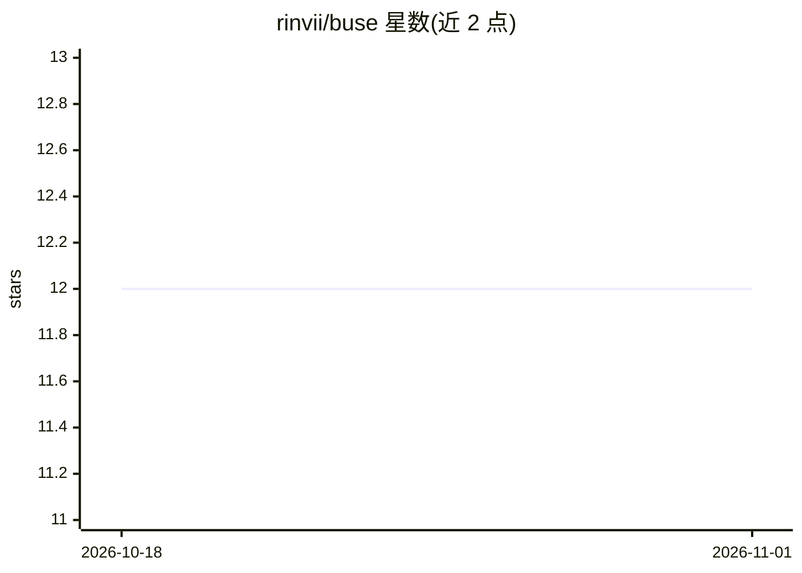

# rinvii/buse

⭐ 12 · Python · MIT · 推送 2026-02-01 · [GitHub](https://github.com/rinvii/buse) · 个人维护

**面向 AI agent 的终端浏览器控制 CLI**

buse 是一个无状态命令行工具，把浏览器操作（点击、输入、滚动、执行 JS、搜索等）转化为结构化的单行命令，供 AI agent 与自动化脚本调用。支持多实例并行、会话状态导出（cookies/storage）、observe 命令捕获页面语义状态与可选截图及 SoM 标注，extract 命令可调用 LLM 做页面信息抽取（默认 gpt-4o-mini，需 OPENAI_API_KEY）。内置 MCP Server，可将浏览器会话以 Model Context Protocol 暴露给模型客户端。要求 Python 3.12 与本地安装的 Google Chrome。

## 筛选速览

| 维度 | 判定 | 备注 |
|---|---|---|
| AI 角色 | `ai-ecosystem` | LLM/agent 周边工具 |
| 许可风险 | `permissive` | MIT |
| 部署形态 | `library` | 以包/库形式分发 |
| 模型依赖 | — | README 未给出锁定关系 |
| 硬件要求 | — | 无带数字的原话,不猜 |
| 安装摩擦 | `low` | 无编译、无系统依赖或容器化 |
| 成熟度 | — | 结构信号不足 |

## 能力要点

- 浏览器操作转化为单行 CLI 原语（点击/输入/拖拽/执行 JS 等 30+ 命令）
- observe 捕获语义状态、截图与 SoM 标注，输出 JSON 供 agent 消费
- 内置 MCP Server，暴露全部 CLI 动作为 MCP 工具
- save-state 导出 cookies/storage 以维持登录会话

## 适用场景

- 让 AI agent 通过终端命令控制浏览器完成任务
- 自动化脚本做网页抓取与交互
- 通过 MCP 协议把浏览器会话接入模型客户端

## 场景标签

`浏览器自动化` `网页抓取` · 领域:效率与自动化

## 证据(README 行号)

> L10: buse is a stateless CLI designed for AI agents and automation scripts. It turns complex browser interaction into si
> L153: Expose the active browser instances via the Model Context Protocol.

## 星数曲线

2026-10-18 12 → 2026-11-01 12（+0）

---
*卡片 v1 · prompt 1.4 · 生成 2026-11-01 · 置信度 high · 依据 README sha `6138b2d82397` · [字段定义](../../DATASET.md)*
