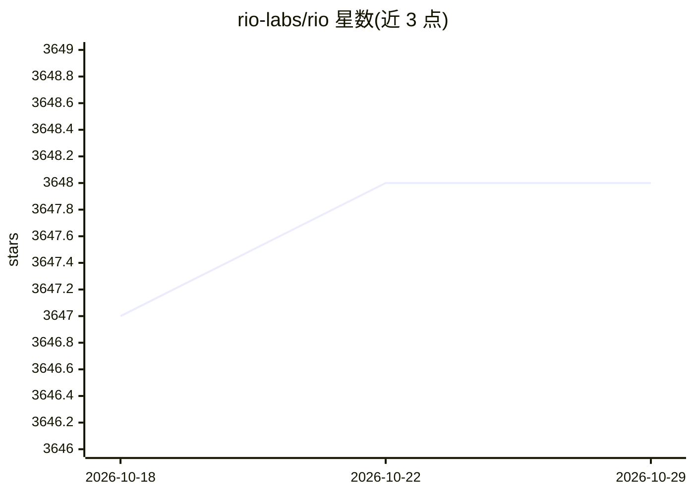

# rio-labs/rio

⭐ 3,648 · Python · Apache-2.0 · 推送 2026-10-26 · [GitHub](https://github.com/rio-labs/rio) · [官网](https://rio.dev) · 组织维护

**纯 Python 构建 Web 与桌面应用的 UI 框架，无需 HTML/CSS/JS**

基于 Python 的声明式 UI 框架，将 React 风格组件引入 Python：提供 50 余个内置组件（如 rio.Button、rio.Text），可组合为自定义组件与完整应用；应用可本地运行也可部署到 Web。完全类型安全以配合现代编辑器，附带开发工具。通过 PyPI 以 pip install rio-ui 安装，并提供 rio 命令行工具按模板（如井字棋）创建并运行项目。采用 Apache-2.0 许可证。

## 筛选速览

| 维度 | 判定 | 备注 |
|---|---|---|
| AI 角色 | `ai-ecosystem` | LLM/agent 周边工具 |
| 许可风险 | `permissive` | Apache-2.0 |
| 部署形态 | `library` | 以包/库形式分发 |
| 模型依赖 | — | README 未给出锁定关系 |
| 硬件要求 | — | 无带数字的原话,不猜 |
| 安装摩擦 | `low` | 无编译、无系统依赖或容器化 |
| 成熟度 | — | 结构信号不足 |

## 能力要点

- 声明式 UI，100% Python，无需 HTML/CSS/JavaScript
- 50 余个内置组件可组合为自定义组件与完整应用
- 应用可本地运行也可部署到 Web
- rio 命令行工具提供多模板项目创建（rio new / rio run）

## 适用场景

- 用纯 Python 快速搭建数据展示或 CRUD 类 Web 应用
- 复用 React 风格组件体系构建自定义界面
- 同一代码在本地与 Web 环境运行应用

## 场景标签

 · 领域:应用开发框架/UI

## 证据(README 行号)

> L3:  Rio is an easy to use framework for creating websites and apps and is based entirely on Python . 🐍
> L25: - Modern, **declarative UI** framework

## 星数曲线

2026-10-18 3,647 → 2026-10-29 3,648（+1）

---
*卡片 v1 · prompt 1.4 · 生成 2026-10-20 · 置信度 high · 依据 README sha `30ebeb0f9a03` · [字段定义](../../DATASET.md)*
