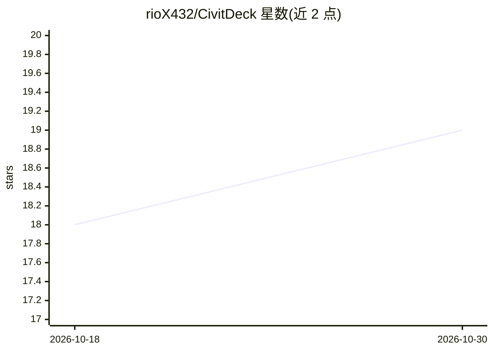

# rioX432/CivitDeck

⭐ 19 · Kotlin · MIT · 推送 2026-10-24 · [GitHub](https://github.com/rioX432/CivitDeck) · 个人维护

**CivitAI 移动客户端：浏览、搜索并桥接本地 ComfyUI 生成**

基于 Kotlin Multiplatform 的 CivitAI 第三方移动客户端，覆盖 Android、iOS 与 Desktop 三端。功能包括模型搜索与滑动浏览、图像画廊、提示词元数据查看与模板、收藏与合集。核心机制是将 CivitAI 上发现的模型桥接到本地生成环境：可向 ComfyUI 或 Automatic1111/Forge 发送模型、管理生成队列、WebSocket 实时预览、服务器硬件监控，并支持将生成结果整理为带标注的训练数据集。非官方客户端，数据通过 CivitAI 公共 API 获取。

## 筛选速览

| 维度 | 判定 | 备注 |
|---|---|---|
| AI 角色 | `ai-ecosystem` | LLM/agent 周边工具 |
| 许可风险 | `permissive` | MIT |
| 部署形态 | `None` |  |
| 模型依赖 | — | README 未给出锁定关系 |
| 硬件要求 | — | 无带数字的原话,不猜 |
| 安装摩擦 | `low` | 无编译、无系统依赖或容器化 |
| 成熟度 | `idea` | |

## 能力要点

- 向 ComfyUI 或 Automatic1111/Forge 发送模型并管理生成队列与历史
- 实时 WebSocket 预览 ComfyUI 生成进度并支持中断
- 生成输出整理为带自动标注与去重的 AI 训练数据集
- CivitAI、HuggingFace、TensorArt 多源统一搜索

## 适用场景

- 在手机上快速浏览和搜索 CivitAI 模型与提示词
- 把发现的模型直接推送到本地 ComfyUI/A1111 工作流使用
- 把生成结果整理为 LoRA 训练数据集

## 场景标签

`图像生成` · 领域:内容生成

## 证据(README 行号)

> L5: **The CivitAI app for discovery — browse, personalize, and find the models & prompts you want**
> L41: - **ComfyUI & SD WebUI Integration** — send models to ComfyUI or Automatic1111/Forge, manage the generation queue, 

## 星数曲线

2026-10-18 18 → 2026-10-30 19（+1）

---
*卡片 v1 · prompt 1.4 · 生成 2026-10-29 · 置信度 high · 依据 README sha `788abe8efa25` · [字段定义](../../DATASET.md)*
