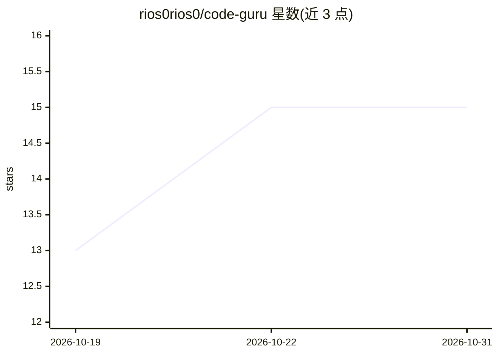

# rios0rios0/code-guru

⭐ 15 · Go · MIT · 推送 2026-10-28 · [GitHub](https://github.com/rios0rios0/code-guru) · 个人维护

**用 AI 自动审查 GitHub/Azure DevOps PR 的 CLI 工具**

Go 编写的命令行工具与 webhook 服务器，调用三种 AI 后端（Anthropic Messages API、Claude Code CLI、OpenAI Chat Completions API）自动审查 GitHub 与 Azure DevOps 的拉取请求，依据 Markdown 规则文件（支持 frontmatter 按文件 glob 过滤）执行编码规范检查，并将行内评论与总体裁决（approve/request_changes/comment）回帖到 PR。附带意图感知审查、Claude Code 代理式六轮全仓审查、Kubernetes Job 执行、@提及触发复审、无需 LLM 的琐碎 PR 自动适配器等机制。通过 go install 或源码构建安装。

## 筛选速览

| 维度 | 判定 | 备注 |
|---|---|---|
| AI 角色 | `ai-native` | 本体是模型或模型工具 |
| 许可风险 | `permissive` | MIT |
| 部署形态 | `self-host` | docker 或自建部署 |
| 模型依赖 | locked-api |  |
| 硬件要求 | — | 无带数字的原话,不猜 |
| 安装摩擦 | `low` | 无编译、无系统依赖或容器化 |
| 成熟度 | — | 结构信号不足 |

## 能力要点

- 三种 AI 后端：Anthropic API、Claude Code CLI、OpenAI API
- Markdown 规则文件 + frontmatter 按文件 glob 过滤
- Claude Code 代理式六轮审查与 Kubernetes Job 执行模式
- @提及触发复审并自动归类/关闭既有评论线程
- 琐碎 PR（依赖更新/版本号/纯文档）适配器免 LLM 自动处理

## 适用场景

- 团队在 CI 中自动审查 PR 并强制执行编码规范
- 通过 PR 评论 @机器人 触发复审并追踪既有问题线程
- 依赖更新等琐碎 PR 免调用 LLM 自动批准以节省 token

## 场景标签

`代码审查` · 领域:编码与开发

## 证据(README 行号)

> L16: A CLI tool that leverages AI (Anthropic Messages API, Claude Code CLI, or OpenAI API) to automatically review pull 
> L21: - Three AI backends: Anthropic Messages API, Claude Code CLI (`claude --print`), or OpenAI Chat Completions API

## 星数曲线

2026-10-19 13 → 2026-10-31 15（+2）

---
*卡片 v1 · prompt 1.4 · 生成 2026-10-30 · 置信度 high · 依据 README sha `0687610216e0` · [字段定义](../../DATASET.md)*
