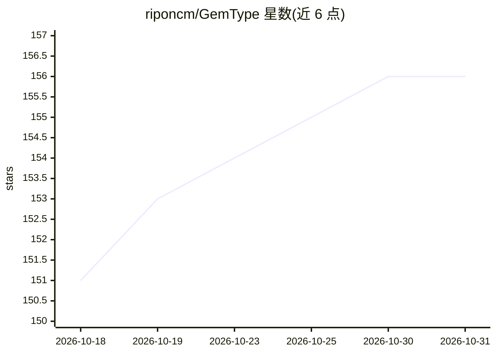

# riponcm/GemType

⭐ 156 · JavaScript · Apache-2.0 · 推送 2026-07-30 · [GitHub](https://github.com/riponcm/GemType) · [官网](https://gemtype.matily.org) · 个人维护

**自带 Gemini key 的浏览器/桌面语法检查与改写工具**

开源 Grammarly 替代品：浏览器扩展（Chrome/Edge/Firefox）、Word 任务窗格加载项和桌面菜单栏应用，用用户自己的 Google AI Studio Gemini API key 在任意文本框做实时语法拼写检查（波浪线+一键修复）、选中文本改写（Improve/Fix/Shorten/Formal/Casual），文本只发往 Gemini API，无中间服务器、无账号。采用 overlay 不改 DOM，防抖检查、缓存与句子级复检控制配额；Google Docs 不支持，暂不能离线或用本地模型。

## 筛选速览

| 维度 | 判定 | 备注 |
|---|---|---|
| AI 角色 | `ai-native` | 本体是模型或模型工具 |
| 许可风险 | `permissive` | Apache-2.0 |
| 部署形态 | `desktop` | 安装包/桌面程序 |
| 模型依赖 | — | README 未给出锁定关系 |
| 硬件要求 | — | 无带数字的原话,不猜 |
| 安装摩擦 | `medium` | 含编译或系统依赖之一 |
| 成熟度 | — | 结构信号不足 |

## 能力要点

- 任意网站文本框实时语法检查与一键修复（Ctrl/Cmd+Z 可撤销）
- 选中文本改写：Improve/Fix/Shorten/Formal/Casual
- 自带 key，文本仅发往 Google Gemini API，无中间服务器与遥测
- 桌面应用（macOS/Windows/Linux）全局热键在任意应用内改写文本

## 适用场景

- 写邮件或社交媒体帖子时实时纠正语法拼写
- 在 Gmail/LinkedIn 等网站一键改写句子风格
- 用免费 Gemini 额度获得跨浏览器和桌面的写作检查

## 场景标签

`AI 写作` · 领域:内容生成

## 证据(README 行号)

> L44: - **Live grammar and spelling checking** — underlines appear in any text field about a second after you stop typing
> L48: - **Context-aware suggestions** — an LLM judges whole sentences in any language, not just pattern rules

## 星数曲线

2026-10-18 151 → 2026-10-31 156（+5）

---
*卡片 v1 · prompt 1.4 · 生成 2026-10-22 · 置信度 mid · 依据 README sha `a9896d2951c8` · [字段定义](../../DATASET.md)*
