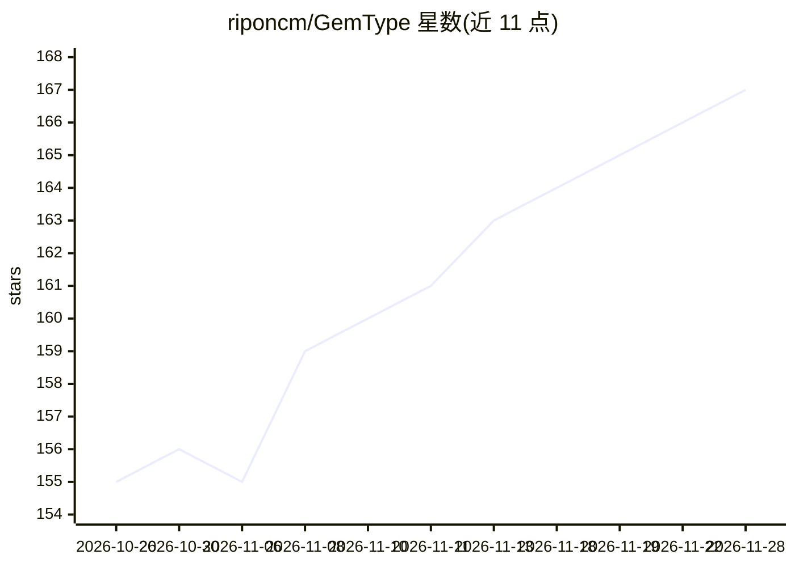

# riponcm/GemType

⭐ 167 · JavaScript · GPL-3.0 · 推送 2026-11-27 · [GitHub](https://github.com/riponcm/GemType) · [官网](https://gemtype.matily.org) · 组织维护

**自带 Gemini API key 的开源语法检查与改写浏览器扩展**

面向在浏览器、Word、桌面与移动端写作的用户，实时标记语法/拼写错误并支持一键修正，另提供 Improve/Fix/Shorten/Formal/Casual 五种改写操作。核心机制是 bring-your-own-key：文本经用户自己的 Gemini API key 直达 Google API，无中间服务器、无遥测。技术实现采用覆盖层定位（不修改页面 DOM）、snippet 锚定、去抖与缓存控制配额。Google Docs 不支持；暂不能接入本地模型（可插拔后端在路线图中）。

## 筛选速览

| 维度 | 判定 | 备注 |
|---|---|---|
| AI 角色 | `ai-native` | 本体是模型或模型工具 |
| 许可风险 | `permissive` | GPL-3.0 |
| 部署形态 | `desktop` | 安装包/桌面程序 |
| 模型依赖 | — | README 未给出锁定关系 |
| 硬件要求 | — | 无带数字的原话,不猜 |
| 安装摩擦 | `medium` | 含编译或系统依赖之一 |
| 成熟度 | — | 结构信号不足 |

## 能力要点

- 浏览器扩展 + Word 加载项 + 桌面托盘应用 + Android/iOS 键盘，多端同一核心
- 覆盖层方式绘制下划线，不修改页面 DOM，兼容 React/Vue/ProseMirror 编辑器
- 去抖检查、未变更文本跳过、结果缓存，控制免费配额消耗
- 自动检测语言，支持 Gemini 可识别的任意语言

## 适用场景

- 在 Gmail、LinkedIn、X、Reddit、GitHub 等网站写作时实时修正语法
- 选中任意文字一键改写语气或长度
- 桌面任意应用中用全局热键修正与改写文本
- 在 Android/iOS 任意应用输入时修正文字

## 场景标签

`AI 写作` · 领域:内容生成

## 证据(README 行号)

> L50: - **Live grammar and spelling checking** — underlines appear in any text field about a second after you stop typing
> L54: - **Context-aware suggestions** — an LLM judges whole sentences in any language, not just pattern rules
> L55: - **Bring your own key** — uses your free Google AI Studio key; no account, no subscription, no middleman server

## 星数曲线

2026-10-26 155 → 2026-11-28 167（+12）

---
*卡片 v1 · prompt 1.4 · 生成 2026-11-27 · 置信度 mid · 依据 README sha `2611622447a7` · [字段定义](../../DATASET.md)*
