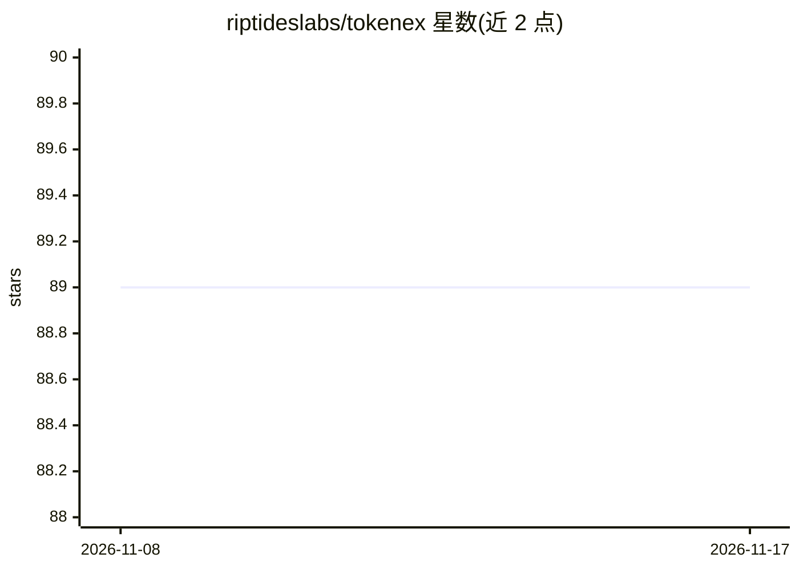

# riptideslabs/tokenex

⭐ 89 · Go · MIT · 推送 2026-11-16 · [GitHub](https://github.com/riptideslabs/tokenex) · [官网](https://riptideslabs.github.io/tokenex/) · 组织维护

**Go 库：用工作负载身份令牌换取短期云凭证**

面向 Go 开发者的凭证获取库：读取工作负载已有的身份令牌（SPIFFE JWT-SVID、GitHub Actions OIDC、静态 JWT），向 AWS、GCP、Azure、OCI、Vault/OpenBao、Conjur、OAuth2 服务器（含 Anthropic 与 OpenAI 的 Workload Identity Federation）换取短期凭证，并在过期前自动刷新，通过 Go channel 交付 Update/Remove/Err 事件，无需存储或轮换长期密钥。任何身份令牌源可与任意凭证提供方组合，亦可实现 token.IdentityTokenProvider 接口自带令牌源。

## 筛选速览

| 维度 | 判定 | 备注 |
|---|---|---|
| AI 角色 | `ai-ecosystem` | LLM/agent 周边工具 |
| 许可风险 | `permissive` | MIT |
| 部署形态 | `None` |  |
| 模型依赖 | — | README 未给出锁定关系 |
| 硬件要求 | — | 无带数字的原话,不猜 |
| 安装摩擦 | `low` | 无编译、无系统依赖或容器化 |
| 成熟度 | — | 结构信号不足 |

## 能力要点

- 身份令牌换取短期云凭证并自动刷新，经 Go channel 交付
- 身份源与凭证提供方任意组合（3 种令牌源 × 13 类提供方）
- 支持 AWS/GCP/Azure/OCI/Vault/Conjur 及 RFC 7523/8693（含 Anthropic、OpenAI WIF）
- 可自定义身份令牌源（IdentityTokenProvider 接口）

## 适用场景

- CI（GitHub Actions）中用 OIDC 令牌换取云凭证，免长期密钥
- SPIFFE/SPIRE 工作负载获取跨云短期凭证
- 为 AI agent 供应短期 OpenAI/Anthropic API key

## 场景标签

 · 领域:云安全/身份与凭证管理

## 证据(README 行号)

> L5: tokenex is a Go library that exchanges an identity token your workload already has, such as a SPIFFE JWT-SVID or a G
> L52: - **RFC 7523** (`pkg/rfc7523`): exchanges ID tokens for OAuth2 access tokens with the `jwt-bearer` grant, including
> L53: - **RFC 8693** (`pkg/rfc8693`): exchanges ID tokens for OAuth2 access tokens with token exchange, including OpenAI 

## 星数曲线

2026-11-08 89 → 2026-11-17 89（+0）

---
*卡片 v1 · prompt 1.4 · 生成 2026-11-17 · 置信度 high · 依据 README sha `74a9d5e4f96f` · [字段定义](../../DATASET.md)*
