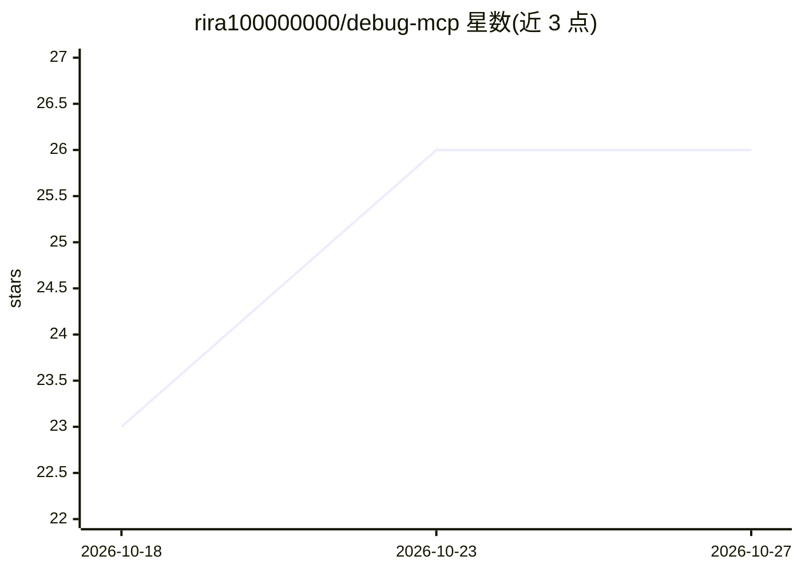

# rira100000000/debug-mcp

⭐ 26 · Ruby · MIT · 推送 2026-10-18 · [GitHub](https://github.com/rira100000000/debug-mcp) · [官网](https://rubygems.org/gems/debug-mcp) · 个人维护

**连接 LLM agent 与 Ruby 运行时调试的 MCP server**

基于 Ruby 的 MCP server，通过 debug gem（rdbg）的 socket 协议连接暂停中的 Ruby/Rails 进程，把运行时状态暴露给 LLM agent：检查局部变量与调用栈、在停止的 binding 中执行 Ruby 代码、设置行/方法/异常断点、step/next/continue 控制执行。Rails 专用工具可读取路由、模型结构、SQL/render/cache/job 事件与 ActionMailer 投递，无需在目标应用安装 gem。支持 STDIO（默认）与 Streamable HTTP 传输，需 Ruby≥3.2；前身为 girb-mcp，0.1.2 起更名。debug gem 本身无鉴权，Docker 场景需限制调试端口访问。

## 筛选速览

| 维度 | 判定 | 备注 |
|---|---|---|
| AI 角色 | `ai-ecosystem` | LLM/agent 周边工具 |
| 许可风险 | `permissive` | MIT |
| 部署形态 | `None` |  |
| 模型依赖 | — | README 未给出锁定关系 |
| 硬件要求 | — | 无带数字的原话,不猜 |
| 安装摩擦 | `low` | 无编译、无系统依赖或容器化 |
| 成熟度 | — | 结构信号不足 |

## 能力要点

- 通过 debug gem wire protocol 连接运行中的 Ruby/Rails 进程
- 断点/单步/异常捕获/在停止 binding 中执行代码等 20+ MCP 工具
- Rails 事件捕获：SQL/render/cache/ActiveJob/请求生命周期
- HTTP 传输需额外安装 rack gem，STDIO 无需额外配置

## 适用场景

- 让 AI agent 代替我调试卡在断点的 Ruby 脚本
- 在 Rails 请求过程中检查变量与 SQL 副作用
- 调试运行在 Docker 容器里的 Rails 应用

## 场景标签

`编码 Agent` · 领域:编码与开发

## 证据(README 行号)

> L5: MCP (Model Context Protocol) server that connects LLM agents to Ruby's debug gem, giving them access to the runtime 
> L373: 1. debug-mcp runs as an MCP server communicating via STDIO (default) or Streamable HTTP
> L375: 3. debug-mcp connects to that socket using the debug gem's wire protocol

## 星数曲线

2026-10-18 23 → 2026-10-27 26（+3）

---
*卡片 v1 · prompt 1.4 · 生成 2026-10-26 · 置信度 high · 依据 README sha `95a76f65b885` · [字段定义](../../DATASET.md)*
