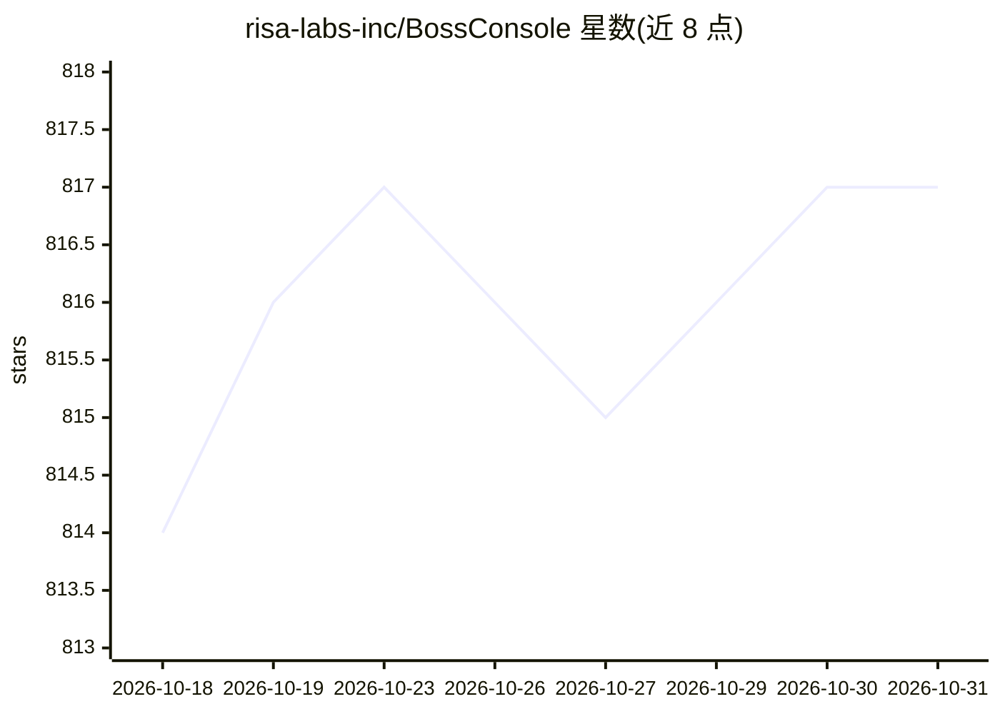

# risa-labs-inc/BossConsole

⭐ 817 · Kotlin · Apache-2.0 · 推送 2026-10-30 · [GitHub](https://github.com/risa-labs-inc/BossConsole) · [官网](https://bossconsole.ai) · 组织维护

**给企业与科研的常驻 AI agent 多平台操作台（JVM 桌面）**

基于 JVM、Kotlin 与 Compose Multiplatform 的桌面工作台，用于运行和管理常驻 AI agent：内置浏览器、终端、编辑器与插件式工具箱（200+ MCP 工具），通过本地 boss MCP 服务器让 Claude Code、Codex、Gemini CLI、OpenCode 等 CLI agent 读取终端输出、操作文件与浏览器标签。提供按工具的开关、角色权限、Secret Manager 与签名插件等访问控制，支持跨设备共享终端与窗口（macOS 14+ 预览），并可用 Tool Creator 创建自定义插件。macOS/Windows/Linux 均有安装包。

## 筛选速览

| 维度 | 判定 | 备注 |
|---|---|---|
| AI 角色 | `ai-ecosystem` | LLM/agent 周边工具 |
| 许可风险 | `permissive` | Apache-2.0 |
| 部署形态 | `None` |  |
| 模型依赖 | — | README 未给出锁定关系 |
| 硬件要求 | — | 无带数字的原话,不猜 |
| 安装摩擦 | `medium` | 含编译或系统依赖之一 |
| 成熟度 | — | 结构信号不足 |

## 能力要点

- 浏览器、终端、编辑器、Git 等以动态插件形式组成工作区，多数插件支持热重载
- 本地 boss MCP 服务器向 CLI agent 暴露工作区工具，按工具粒度控制访问
- Tool Creator 脚手架插件项目，Tool Evolver 检查改进现有工具
- 跨设备共享终端与 BOSS 窗口，含 Secret Manager 与签名插件的凭据/来源机制

## 适用场景

- 让 Claude Code/Codex 等编码 agent 在带浏览器和终端的工作区里常驻运行
- 团队搭建围绕自身业务、可远程跟进的常驻 agent
- 为 agent 定制工具箱并按角色控制其可调用的工具

## 场景标签

`Agent 框架` · 领域:Agent 开发

## 证据(README 行号)

> L7: Create your own always-on agent with a real browser, terminal, editor, and an extensible toolbox. Choose its tools, 
> L55: Bring the CLI you already use. Open a BOSS terminal, connect it through **Toolbox → MCP** or the BossTerm AI menu, 

## 星数曲线

2026-10-18 814 → 2026-10-31 817（+3）

---
*卡片 v1 · prompt 1.4 · 生成 2026-10-22 · 置信度 high · 依据 README sha `1382f98bef5c` · [字段定义](../../DATASET.md)*
