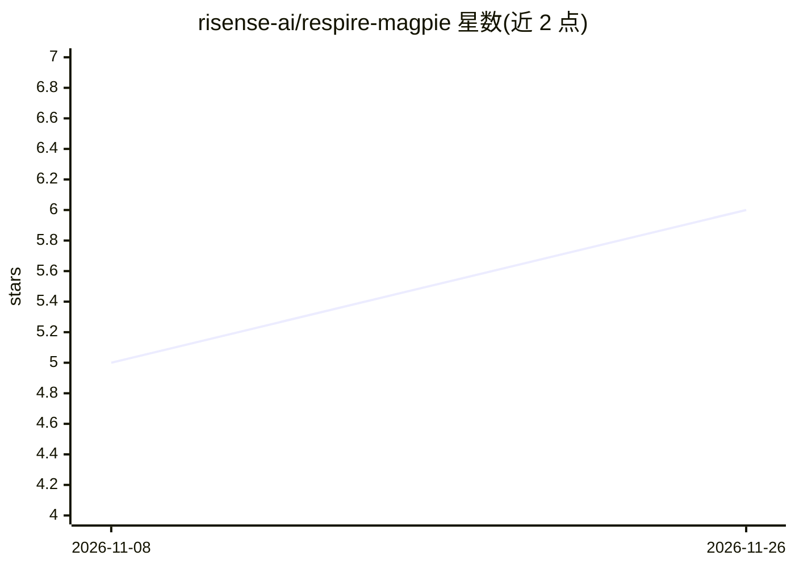

# risense-ai/respire-magpie

⭐ 6 · JavaScript · MIT · 推送 2026-11-02 · [GitHub](https://github.com/risense-ai/respire-magpie) · 组织维护 · 中文 README

**给 AI Agent 装上持续记忆的 Magpie 插件**

respire-memory 是 Magpie 网关的记忆插件：每轮对话先召回并读取引擎完整政策，再注入选中正文；回合完成后自动写过程日记，并用独立模型提炼决定、方法与教训，查重、更新或挂靠后供后续任务使用。支持显式存储、后台归档、大回合分段、证据回读、AES-256-GCM 加密状态与持久去重。依赖 Respire CLI 本体、本地 HTTP Runtime、Magpie 0.1.1273+ 与 Bun 1.3.6+；启用自动归档须配置兼容 Chat Completions 的生成服务。

## 筛选速览

| 维度 | 判定 | 备注 |
|---|---|---|
| AI 角色 | `ai-ecosystem` | LLM/agent 周边工具 |
| 许可风险 | `permissive` | MIT |
| 部署形态 | `library` | 以包/库形式分发 |
| 模型依赖 | — | README 未给出锁定关系 |
| 硬件要求 | — | 无带数字的原话,不猜 |
| 安装摩擦 | `low` | 无编译、无系统依赖或容器化 |
| 成熟度 | — | 结构信号不足 |

## 能力要点

- 每轮自动召回与完整政策读取，回合后后台提炼归档
- 显式存储、查重更新、大回合分段与证据回读
- 状态目录 AES-256-GCM 加密，update 前加密备份、失败关闭
- 持久队列 worker 支持 setup/status/run/recover/evidence 命令

## 适用场景

- 让 Magpie 宿主里的 Agent 跨会话记住决策与教训
- 为多轮任务积累可回读的过程日记与长期结论
- 需要对记忆写入做加密、备份与查重控制的场景

## 场景标签

`Agent 记忆` · 领域:Agent 开发

## 证据(README 行号)

> L7: **respire-memory 帮助 AI Agent 持续自进化。** 它通过 Magpie 接入 Respire：每轮先召回并读取引擎完整政策，再读选中正文；每个完成回合自动保存过程日记，并从对话中提炼决定、方法和教训，查重、
> L44: **首次使用须先安装 Respire 本体。** 本插件只负责 Magpie 接入，记忆库与本地 Runtime 由 Respire CLI 提供。安装方法见 CLI npm 说明，也可从 CLI Releases 下载对应平台版
> L52: 需要 Magpie **0.1.1273+** 和 Bun **1.3.6+**，Respire HTTP Runtime 必须已运行并解锁。推荐 Magpie **0.1.2208+**，以正确识别本机 Agent 的 magp

## 星数曲线

2026-11-08 5 → 2026-11-26 6（+1）

---
*卡片 v1 · prompt 1.4 · 生成 2026-11-21 · 置信度 high · 依据 README sha `9efa339e15fc` · [字段定义](../../DATASET.md)*
