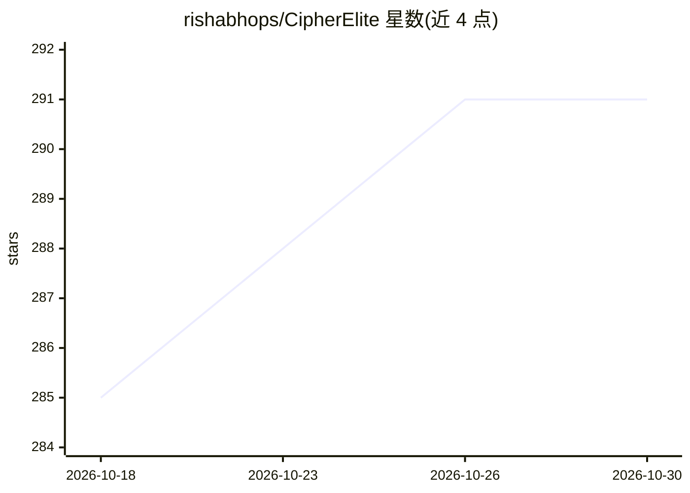

# rishabhops/CipherElite

⭐ 291 · Python · MIT · 推送 2026-10-25 · [GitHub](https://github.com/rishabhops/CipherElite) · [官网](https://cipherelite.in) · 个人维护

**带 AI 插件的 Telegram 用户机器人，自动化任务与群组管理**

基于 Python 与 Telethon 构建的 Telegram userbot，由 Rishabh Anand（Thanos Pro Organization）开发。提供 100+ 官方插件、500+ 命令，覆盖群组管理、自动回复、摘要等 AI 命令及娱乐插件。机制上包括自动扫描并安装缺失依赖的 Smart Plugin Manager、专有 ELITE_SESSION 会话加密（不兼容标准 StringSession）。部署方式有三种：Telegram Deployer Bot 免费托管、VPS/Termux 手动运行（tmux 保持常驻）；配置需 API_ID/API_HASH/ELITE_SESSION 等变量，后端使用 MongoDB。README 声明为教育用途开源项目。

## 筛选速览

| 维度 | 判定 | 备注 |
|---|---|---|
| AI 角色 | `ai-native` | 本体是模型或模型工具 |
| 许可风险 | `permissive` | MIT |
| 部署形态 | `library` | 以包/库形式分发 |
| 模型依赖 | — | README 未给出锁定关系 |
| 硬件要求 | — | 无带数字的原话,不猜 |
| 安装摩擦 | `low` | 无编译、无系统依赖或容器化 |
| 成熟度 | — | 结构信号不足 |

## 能力要点

- 100+ 官方插件与 500+ 命令，含 AI 自动回复/摘要/聊天辅助命令
- Smart Plugin Manager 自动检测并安装缺失依赖
- ELITE_SESSION 会话加密，标准 StringSession 不通用
- 提供 Telegram Deployer Bot 免费托管与 VPS/Termux 两种部署途径

## 适用场景

- 让个人 Telegram 账号自动执行群组管理与任务自动化
- 在聊天中使用 AI 自动回复与摘要命令
- 通过 Deployer Bot 免费托管 24/7 运行 userbot

## 场景标签

`聊天机器人` `工作流自动化` · 领域:效率与自动化

## 证据(README 行号)

> L42: |**🤖 Native AI**|Integrated AI commands for auto-replies, summaries, and chat assistance.|
> L26: Built on **Telethon** by **Rishabh Anand**, it solves the biggest problems in Telegram automation:

## 星数曲线

2026-10-18 285 → 2026-10-30 291（+6）

---
*卡片 v1 · prompt 1.4 · 生成 2026-10-22 · 置信度 low · 依据 README sha `00f25517ab45` · [字段定义](../../DATASET.md)*
