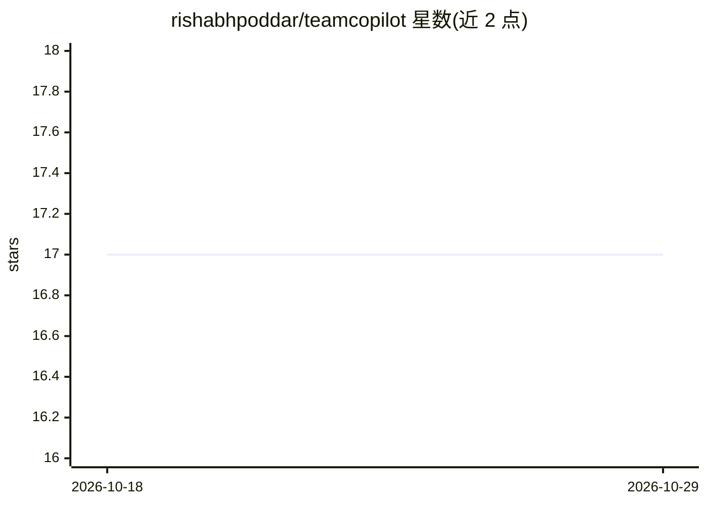

# rishabhpoddar/teamcopilot

⭐ 17 · TypeScript · MIT · 推送 2026-06-23 · [GitHub](https://github.com/rishabhpoddar/teamcopilot) · [官网](https://teamcopilot.ai) · 个人维护

**面向团队的多用户 AI agent 平台：共享技能工作流与审批管控**

多用户 AI agent 平台，将编码类 agent（内嵌 OpenCode agent server）适配到团队使用场景：提供 Web UI 供任意位置的用户与 agent 对话、基于文件系统的共享技能与工作流、按角色的权限控制、高风险操作的审批门、聊天会话与文件 diff 的审计记录，以及采用代理模型的密钥管理（密钥不进入 LLM 上下文）。后端含 Prisma + SQLite 存储，通过 npx 命令本地部署，需 Node.js 20+、npm 与 Python 3.10+。

## 筛选速览

| 维度 | 判定 | 备注 |
|---|---|---|
| AI 角色 | `ai-ecosystem` | LLM/agent 周边工具 |
| 许可风险 | `permissive` | MIT |
| 部署形态 | `library` | 以包/库形式分发 |
| 模型依赖 | — | README 未给出锁定关系 |
| 硬件要求 | — | 无带数字的原话,不猜 |
| 安装摩擦 | `low` | 无编译、无系统依赖或容器化 |
| 成熟度 | — | 结构信号不足 |

## 能力要点

- 共享技能与工作流，以真实文件/文件夹形式存储
- 审批门与权限控制：决定谁可查看/编辑/批准/运行资源
- 密钥代理模型：agent 使用密钥但无需看到明文
- 聊天会话历史与文件 diff 审计

## 适用场景

- 团队集中管理 agent 技能并在多用户间复用
- 对高风险自动化操作设置审批与审计流程
- 为无 shell 权限的支撑/产品团队提供受控 agent 工具
- 通过 Web UI 远程访问部署在本地机器上的 agent

## 场景标签

`工作流自动化` `编码 Agent` · 领域:效率与自动化

## 证据(README 行号)

> L4: TeamCopilot is a multi-user AI agent platform for teams that want the power of coding agents without giving up contr
> L120: - the backend runs the TeamCopilot server and the embedded OpenCode agent server

## 星数曲线

2026-10-18 17 → 2026-10-29 17（+0）

---
*卡片 v1 · prompt 1.4 · 生成 2026-10-29 · 置信度 high · 依据 README sha `75c19706859a` · [字段定义](../../DATASET.md)*
