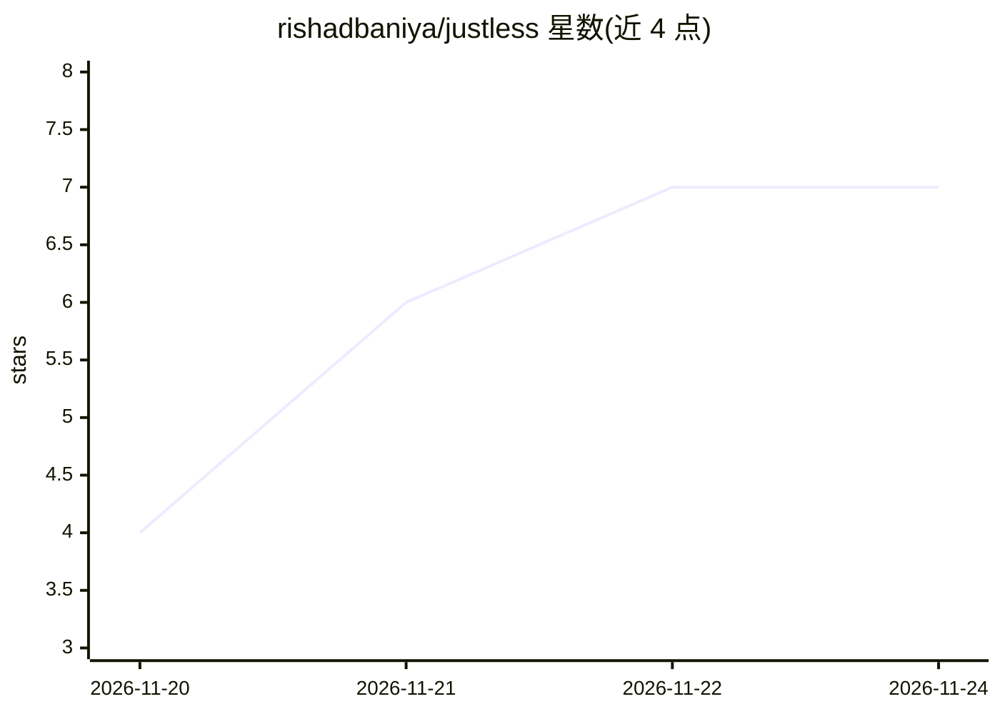

# rishadbaniya/justless

⭐ 7 · Rust · Apache-2.0 · 推送 2026-11-21 · [GitHub](https://github.com/rishadbaniya/justless) · 个人维护

**为编码 agent 压缩工具输出与代码上下文的本地 CLI**

位于编码 agent 与其工具之间的本地二进制：通过 hooks、MCP 或 CLI 接入，将命令输出转为分组报告，用本地代码图回答符号定义/调用问题，提供大纲式读取与按符号精确回读。每个字节以 SHA-256 归档于 .justless/，可用 log/expand 按行号精确重放。100% 本地运行、无网络调用、无 LLM 依赖。安装脚本用 Cargo 从源码构建，需 Rust 1.91+ 和 C 编译器。

## 筛选速览

| 维度 | 判定 | 备注 |
|---|---|---|
| AI 角色 | `ai-ecosystem` | LLM/agent 周边工具 |
| 许可风险 | `permissive` | Apache-2.0 |
| 部署形态 | `None` |  |
| 模型依赖 | — | README 未给出锁定关系 |
| 硬件要求 | — | 无带数字的原话,不猜 |
| 安装摩擦 | `low` | 无编译、无系统依赖或容器化 |
| 成熟度 | — | 结构信号不足 |

## 能力要点

- 命令输出压缩为分组报告，原始输出归档并可按行精确重放
- 本地代码图支持 query/path/pack/lookup/affected 一调用回答
- 26 种语言的大纲与符号级 expand/edit
- 密钥脱敏与仅运行受影响测试

## 适用场景

- 减少编码 agent 会话中的上下文 token 消耗
- 让 agent 不读整个大文件即可回答'X 在哪定义、谁调用'
- 在 Claude Code/Codex/Cursor 等 agent 中通过 hooks 接入

## 场景标签

`编码 Agent` · 领域:编码与开发

## 证据(README 行号)

> L12: **justless** sits between your coding agent and its tools. It turns command output into compact reports, answers co
> L63: Token-saving tools each take one slice of the context window. RTK compresses command output, graphify answers code 
> L156:  Your agent reaches Justless through hooks, MCP or the CLI. Justless turns commands, code lookups and old tool res

## 星数曲线

2026-11-20 4 → 2026-11-24 7（+3）

---
*卡片 v1 · prompt 1.4 · 生成 2026-11-21 · 置信度 high · 依据 README sha `1e0b1316d238` · [字段定义](../../DATASET.md)*
