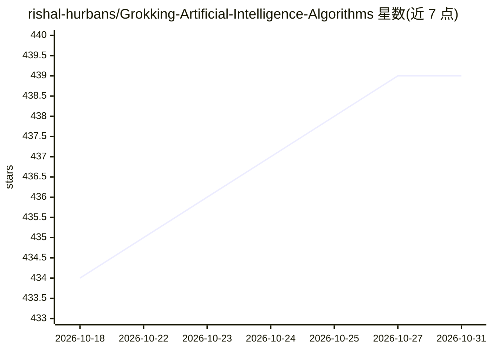

# rishal-hurbans/Grokking-Artificial-Intelligence-Algorithms

⭐ 439 · Python · AGPL-3.0 · 推送 2026-08-06 · [GitHub](https://github.com/rishal-hurbans/Grokking-Artificial-Intelligence-Algorithms) · [官网](https://www.manning.com/books/grokking-ai-algorithms-second-edition) · 个人维护

**《Grokking AI Algorithms》书籍配套示例代码仓库**

Manning 出版书籍《Grokking Artificial Intelligence Algorithms》（作者 Rishal Hurbans）的官方配套代码库，按章节组织示例实现，涵盖智能搜索、A*、遗传算法、蚁群优化、神经网络、线性回归、生成式 AI 等算法主题。README 提供 Python 3.9+ 环境搭建、虚拟环境创建、依赖安装与逐章运行脚本的步骤，另提供浏览器中的交互式代码笔记本入口。作者注明示例结合书籍阅读效果更好，但也可独立用作算法实现的技术参考。

## 筛选速览

| 维度 | 判定 | 备注 |
|---|---|---|
| AI 角色 | `ai-knowledge` | 知识聚合/清单类 |
| 许可风险 | `viral` | AGPL-3.0 |
| 部署形态 | `library` | 以包/库形式分发 |
| 模型依赖 | — | README 未给出锁定关系 |
| 硬件要求 | — | 无带数字的原话,不猜 |
| 安装摩擦 | `medium` | 含编译或系统依赖之一 |
| 成熟度 | — | 结构信号不足 |

## 能力要点

- 按书籍章节组织的算法示例代码（搜索/进化算法/神经网络/生成式 AI 等）
- 提供 Python 虚拟环境与依赖安装的完整步骤
- 提供浏览器中的交互式代码笔记本入口
- 第 11–12 章重型示例支持 PyTorch 兼容 GPU（可选）

## 适用场景

- 配合书籍学习 AI 算法的编程实现
- 实现特定算法时查阅参考代码
- 在浏览器交互式笔记本中探索示例代码

## 场景标签

`教程课程` · 领域:学习与行业

## 证据(README 行号)

> L1: # Grokking AI Algorithms
> L36: This is the official supporting code for the book, Grokking AI Algorithms, published by Manning Publications, autho
> L42: The purpose of this repository is to act as a practical reference for examples of how the algorithms mentioned in t

## 星数曲线

2026-10-18 434 → 2026-10-31 439（+5）

---
*卡片 v1 · prompt 1.4 · 生成 2026-10-21 · 置信度 mid · 依据 README sha `036231110ad3` · [字段定义](../../DATASET.md)*
