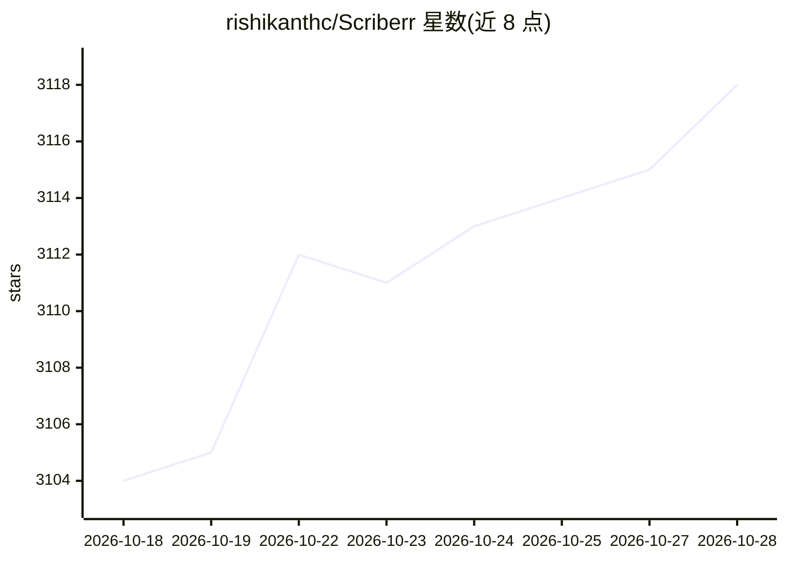

# rishikanthc/Scriberr

⭐ 3,120 · Go · MIT · 推送 2026-09-20 · [GitHub](https://github.com/rishikanthc/Scriberr) · [官网](https://scriberr.app) · 个人维护

**自托管者的本地离线音频/视频转写 Web 应用**

开源、完全离线的音频与视频转写应用，面向重视隐私的自托管用户。在本地机器运行 Whisper、NVIDIA Parakeet/Canary 等模型生成带词级时间戳的文本，支持说话人分离标注、与转录文本对话（接 Ollama 或 OpenAI 兼容 API）、AI 摘要、文件夹监听自动处理与 API 集成（如 n8n），内置录音与笔记功能，支持 PWA 安装。提供 Homebrew 安装与 Docker 部署（CPU/CUDA 多种镜像），首次启动需初始化 Python 环境并下载模型。

## 筛选速览

| 维度 | 判定 | 备注 |
|---|---|---|
| AI 角色 | `ai-native` | 本体是模型或模型工具 |
| 许可风险 | `permissive` | MIT |
| 部署形态 | `self-host` | docker 或自建部署 |
| 模型依赖 | local-ok | 支持本地模型 |
| 硬件要求 | — | 无带数字的原话,不猜 |
| 安装摩擦 | `low` | 无编译、无系统依赖或容器化 |
| 成熟度 | — | 结构信号不足 |

## 能力要点

- 本地运行 Whisper/NVIDIA Parakeet/Canary 等模型，词级时间戳转写
- 说话人分离（Diarization）自动标注
- 与转录文本对话：支持 Ollama 与 OpenAI 兼容 API
- Folder Watcher 自动处理新文件并提供 API，可接入 n8n 等自动化

## 适用场景

- 在自有服务器上离线转写会议录音和语音备忘，不上传云端
- 转写后直接对内容提问、生成摘要并做笔记高亮
- 用文件夹监听和 API 把转写纳入现有自动化流程

## 场景标签

`语音识别` `文档问答` · 领域:知识与检索

## 证据(README 行号)

> L1: Scriberr is an open-source, and completely offline audio transcription application designed for self-hosters who val
> L39: At its core, Scriberr allows you to transcribe audio and video locally on your machine, ensuring no data is ever se
> L45: - **Smart Speaker Detection**: Scriberr automatically detects different speakers (Diarization) and labels exactly w

## 星数曲线

2026-10-18 3,104 → 2026-10-28 3,118（+14）

---
*卡片 v1 · prompt 1.4 · 生成 2026-10-20 · 置信度 high · 依据 README sha `9e4c6d422108` · [字段定义](../../DATASET.md)*
