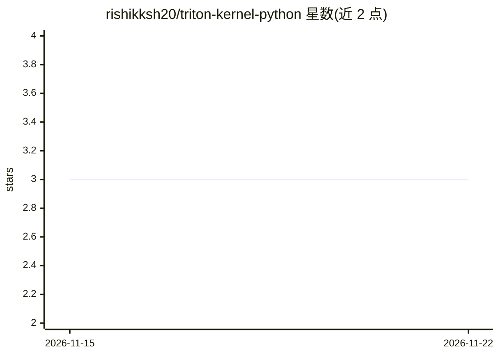

# rishikksh20/triton-kernel-python

⭐ — · [GitHub]() · 个人维护

**面向 LLM 优化开发者的 Triton GPU 内核教程知识库**

以 31 篇自包含 Markdown 教程组织的 Triton 内核实践知识库，从 GPU 架构与向量加法起步，依次覆盖归约、归一化、分块矩阵乘、FlashAttention、量化、解码注意力、MoE 路由与专家计算等模式；每篇教程关联公式、PyTorch 参考实现、Triton 内核、正确性检查与可在自有 GPU 上运行的基准测试。要求 Linux x86_64、Python 3.12/3.13、支持 CUDA 12.8 的 NVIDIA GPU 与 uv 环境管理器；基础指南以 H100 SXM 为硬件参考，性能图为基于模型的计算而非实测。Apache 2.0 许可。

## 筛选速览

| 维度 | 判定 | 备注 |
|---|---|---|
| AI 角色 | `ai-knowledge` | 知识聚合/清单类 |
| 许可风险 | `permissive` | — |
| 部署形态 | `None` |  |
| 模型依赖 | — | README 未给出锁定关系 |
| 硬件要求 | — | 无带数字的原话,不猜 |
| 安装摩擦 | `medium` | 含编译或系统依赖之一 |
| 成熟度 | — | 结构信号不足 |

## 能力要点

- 31 篇自包含 Markdown 教程与 30 个主题的纯 Triton 内核文件
- 每篇含 PyTorch 参照、正确性检查与基准测试
- 覆盖 FlashAttention、量化 GEMM、Paged KV cache、MoE 路由等内核模式
- uv 管理的隔离环境，CUDA 12.8 PyTorch wheel 源

## 适用场景

- 按学习序列系统练习 Triton GPU 内核编写
- 为 LLM 推理优化参考注意力与量化的内核实现
- 在自己的 GPU 上复现各内核的正确性与性能对比

## 场景标签

`教程课程` · 领域:学习与行业

## 证据(README 行号)

> L1: # Kernel Triton Tutorial and Practice Knowledge Base
> L5: The repository contains a GPU fundamentals guide, **31 self-contained Markdown tutorials**, a standalone matrix mult
> L20: - A compatible NVIDIA GPU with a working NVIDIA driver that supports CUDA 12.8.

## 星数曲线

2026-11-15 3 → 2026-11-22 3（+0）

---
*卡片 v1 · prompt 1.4 · 生成 2026-11-22 · 置信度 high · 依据 README sha `d360dea2db1d` · [字段定义](../../DATASET.md)*
