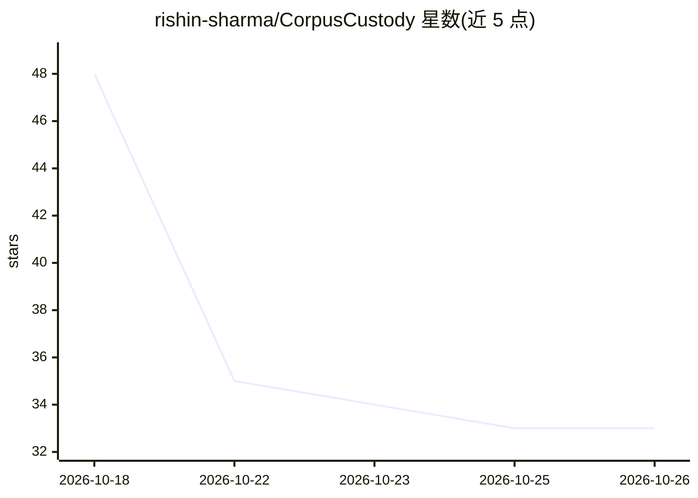

# rishin-sharma/CorpusCustody

⭐ 33 · Python · MIT · 推送 2026-09-04 · [GitHub](https://github.com/rishin-sharma/CorpusCustody) · 个人维护

**训练数据许可证与来源合规门：按用途校验 SPDX 义务并拦截语料入库**

纯标准库 Python 3.11 实现的 CLI 工具，面向需要管理训练语料合规的开发者与企业。读取三字段（record_id | spdx_id | source）的清单文件，离线解析每条记录的 SPDX 许可证，映射为五种义务（署名/相同方式共享/非商业/禁止演绎/未知），再按声明用途（internal/commercial/redistribute）套用固定规则表判定 PASS 或 REFUSE。未知来源记录被视为携带全部限制性义务，任何用途下均阻断放行，且不可通过参数放宽；输出字节级确定、可 diff。无网络访问与第三方依赖。

## 筛选速览

| 维度 | 判定 | 备注 |
|---|---|---|
| AI 角色 | `ai-ecosystem` | LLM/agent 周边工具 |
| 许可风险 | `permissive` | MIT |
| 部署形态 | `library` | 以包/库形式分发 |
| 模型依赖 | — | README 未给出锁定关系 |
| 硬件要求 | — | 无带数字的原话,不猜 |
| 安装摩擦 | `low` | 无编译、无系统依赖或容器化 |
| 成熟度 | — | 结构信号不足 |

## 能力要点

- 离线 SPDX 义务表，五种义务构成全部判定词汇
- 按三种声明用途套用固定规则表，输出 PASS/REFUSE
- 未知来源（空字段或未识别标识符）在任何用途下均阻断，不可放宽
- 纯标准库实现，无第三方依赖、无网络访问

## 适用场景

- 发布商用模型前检查混合语料是否含 share-alike 或非商业记录
- 数据管线入库前自动化拦截来源未标注的抓取数据
- 对比同一语料集在内部研究/商用/再分发三种用途下的合规差异

## 场景标签

 · 领域:数据治理/法务合规工具

## 证据(README 行号)

> L22: CorpusCustody is a training-data license and provenance gate. It walks a dataset
> L30: Python 3.11, standard library only. No third-party dependencies and no network

## 星数曲线

2026-10-18 48 → 2026-10-26 33（-15）

---
*卡片 v1 · prompt 1.4 · 生成 2026-10-25 · 置信度 high · 依据 README sha `ff26d8df514a` · [字段定义](../../DATASET.md)*
