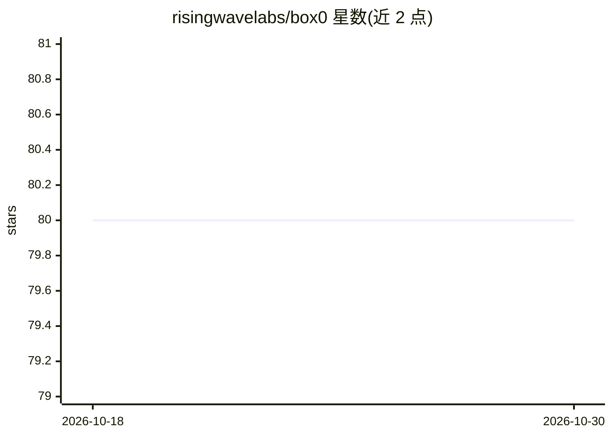

# risingwavelabs/box0

⭐ 80 · Rust · MIT · 推送 2026-04-06 · [GitHub](https://github.com/risingwavelabs/box0) · [官网](https://box0.dev/) · 组织维护

**自托管子代理与代理团队运行平台：并行、持久、定时调度**

Box0 是用 Rust 实现的单二进制自托管平台，用于创建、调度并收集多个 AI 代理的结果。每个代理具备名称、指令与触发器（手动/Cron/Webhook），由服务器存储代理定义、路由任务、运行调度器并提供 Web 仪表盘；守护进程轮询任务收件箱，为每个 worker 单独启动一个 Claude Code 或 Codex 进程，结果写回。代理跨会话持久化，支持工作区多人共享、Slack 通知、管道传参，默认 30 分钟执行超时。通过 npm 安装 CLI，代理经 npx skills 安装技能后由 AI 自行调用 b0 命令。

## 筛选速览

| 维度 | 判定 | 备注 |
|---|---|---|
| AI 角色 | `ai-ecosystem` | LLM/agent 周边工具 |
| 许可风险 | `permissive` | MIT |
| 部署形态 | `library` | 以包/库形式分发 |
| 模型依赖 | — | README 未给出锁定关系 |
| 硬件要求 | — | 无带数字的原话,不猜 |
| 安装摩擦 | `low` | 无编译、无系统依赖或容器化 |
| 成熟度 | — | 结构信号不足 |

## 能力要点

- 手动/Cron/Webhook 三种触发方式调度代理
- 为每个 worker 隔离目录并单独启动 Claude Code 或 Codex 进程
- 工作区多人共享、Slack 通知与 Web 仪表盘
- 单 Rust 二进制，代理与对话跨会话持久化

## 适用场景

- 让多个 AI 代理并行执行 PR 审查、日志巡检等任务
- 按 Cron 周期或 Webhook 事件自动触发代理工作
- 团队共享一台 Box0 服务器协作管理代理

## 场景标签

`多智能体` `Agent 框架` · 领域:Agent 开发

## 证据(README 行号)

> L9: Box0 runs multiple AI agents in parallel. You create agents with different roles, trigger them on demand or on a sch
> L31: A **server** coordinates everything. It stores agent definitions, routes tasks, runs the scheduler, and serves a we
> L51: Your agent creates workers with `b0 add` and sends tasks via `b0 run`. The server stores tasks in an inbox. A daemo

## 星数曲线

2026-10-18 80 → 2026-10-30 80（+0）

---
*卡片 v1 · prompt 1.4 · 生成 2026-10-24 · 置信度 high · 依据 README sha `bc79deb2713c` · [字段定义](../../DATASET.md)*
