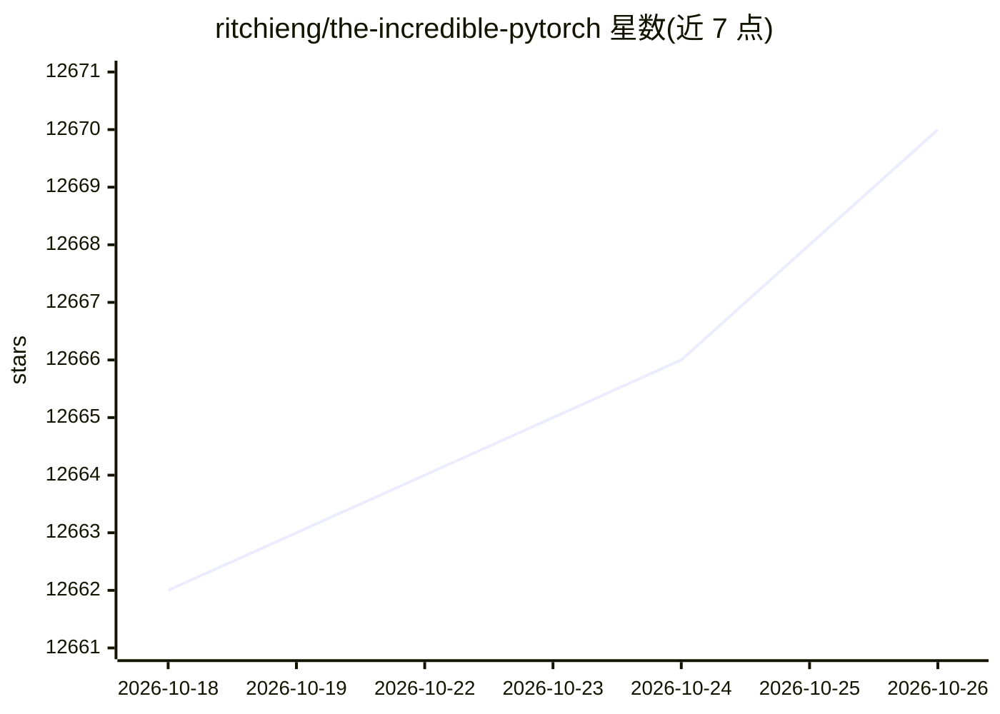

# ritchieng/the-incredible-pytorch

⭐ 12,670 · MIT · 推送 2026-09-23 · [GitHub](https://github.com/ritchieng/the-incredible-pytorch) · 个人维护

**PyTorch 生态策展清单：教程、论文、项目与社区资源汇总**

由个人维护的 PyTorch 相关资源 curated list，收录教程、官方示例、LLM 项目（Llama、Mixtral、Qwen 等）、Agentic AI 框架、AI 安全工具、表格学习、可视化、目标检测、架构搜索与优化算法等类目，通过表格目录组织，以 pull request 方式接受贡献。本体是资源索引而非可安装运行的软件，无安装命令与硬件要求。

## 筛选速览

| 维度 | 判定 | 备注 |
|---|---|---|
| AI 角色 | `ai-knowledge` | 知识聚合/清单类 |
| 许可风险 | `permissive` | MIT |
| 部署形态 | `None` |  |
| 模型依赖 | — | README 未给出锁定关系 |
| 硬件要求 | — | 无带数字的原话,不猜 |
| 安装摩擦 | `medium` | 含编译或系统依赖之一 |
| 成熟度 | — | 结构信号不足 |

## 能力要点

- 按教程/LLM/Agent/AI 安全/目标检测等 20+ 类目组织资源
- 覆盖 LLM 训练、微调、量化与推理引擎条目
- 以 pull request 方式开放社区贡献

## 适用场景

- 查找 PyTorch 各领域教程与入门资料
- 发现 LLM 微调、量化、Agent 框架等工具条目
- 了解 PyTorch 生态相关论文与项目分布

## 场景标签

`精选清单` `教程课程` · 领域:学习与行业

## 证据(README 行号)

> L1: This is a curated list of tutorials, projects, libraries, videos, papers, books and anything related to the incredib
> L3: # Table Of Contents

## 星数曲线

2026-10-18 12,662 → 2026-10-26 12,670（+8）

---
*卡片 v1 · prompt 1.4 · 生成 2026-10-20 · 置信度 high · 依据 README sha `e32e341d38bf` · [字段定义](../../DATASET.md)*
