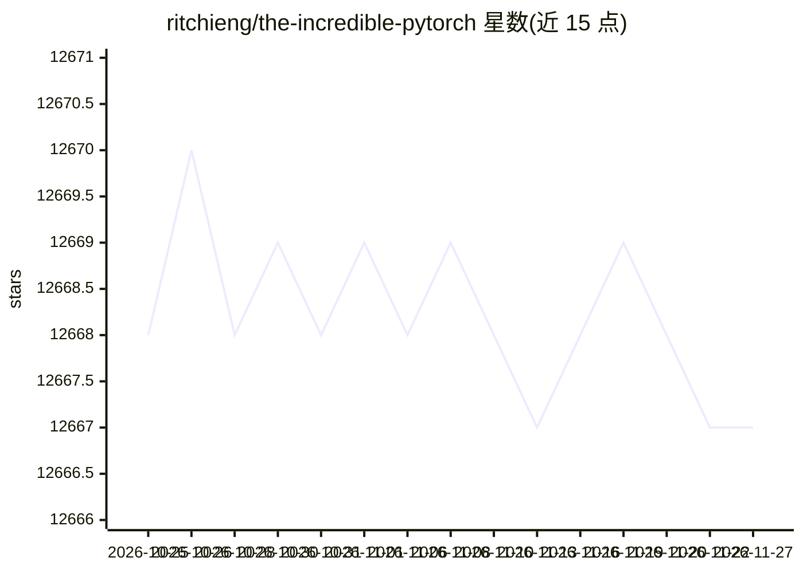

# ritchieng/the-incredible-pytorch

⭐ 12,667 · MIT · 推送 2026-11-12 · [GitHub](https://github.com/ritchieng/the-incredible-pytorch) · 个人维护

**PyTorch 相关教程、论文、项目与社区的资源清单**

以清单形式组织 PyTorch 生态资源，收录教程、官方示例、书籍、视频、论文与项目链接，并按主题分节：LLM 训练与推理、Agent 框架、AI 安全与护栏、表格数据、可视化与可解释性、目标检测、长尾/分布外识别、架构搜索、优化器等。条目以外部仓库或文章链接为主，欢迎通过 pull request 贡献，本身不提供代码或安装产物。

## 筛选速览

| 维度 | 判定 | 备注 |
|---|---|---|
| AI 角色 | `ai-knowledge` | 知识聚合/清单类 |
| 许可风险 | `permissive` | MIT |
| 部署形态 | `None` |  |
| 模型依赖 | — | README 未给出锁定关系 |
| 硬件要求 | — | 无带数字的原话,不猜 |
| 安装摩擦 | `medium` | 含编译或系统依赖之一 |
| 成熟度 | — | 结构信号不足 |

## 能力要点

- 按 20+ 主题分节的 PyTorch 资源目录（LLM、Agent、安全、检测等）
- 收录教程、论文、书籍、视频、项目等多类资源
- 开放 pull request 持续贡献

## 适用场景

- 为学习 PyTorch 查找系统教程与示例项目
- 为研究课题检索目标检测、可解释性等方向的实现与论文
- 了解 LLM 微调、量化、Agent 等细分领域的可用工具

## 场景标签

`精选清单` · 领域:学习与行业

## 证据(README 行号)

> L1: This is a curated list of tutorials, projects, libraries, videos, papers, books and anything related to the incredib
> L5: ## Tutorials
> L29: ## Large Language Models (LLMs)

## 星数曲线

2026-10-25 12,668 → 2026-11-27 12,667（-1）

---
*卡片 v1 · prompt 1.4 · 生成 2026-11-22 · 置信度 high · 依据 README sha `92b053eb3370` · [字段定义](../../DATASET.md)*
