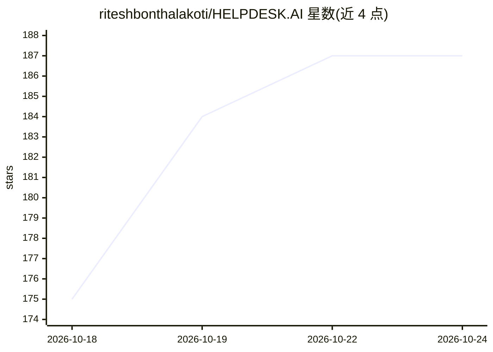

# riteshbonthalakoti/HELPDESK.AI

⭐ 187 · JavaScript · MIT · 推送 2026-07-19 · [GitHub](https://github.com/riteshbonthalakoti/HELPDESK.AI) · [官网](https://helpdeskai1918.vercel.app) · 个人维护

**多租户 AI 工单平台：自动分类工单、查重与建议修复**

基于 FastAPI 后端与 React 前端的全栈帮助台/工单系统，面向企业 IT 支持团队。AI 功能包括：DistilBERT 工单分类与优先级判定、NER 自动提取主机名/序列号/IP、sentence-transformers 语义查重防工单洪水、截图 OCR 提取错误码，以及 GitHub Models/Gemini 生成即时修复建议。架构上采用 4 层权限矩阵（Master Admin/Company Admin/Standard User/Public），基于 Supabase 实现多租户隔离，并分发 Android APK。限制：本地部署需自行配置 Supabase/Stripe 等环境变量；ServiceNow 同步与语音客服仍在路线图中。

## 筛选速览

| 维度 | 判定 | 备注 |
|---|---|---|
| AI 角色 | `ai-enhanced` | 去掉 AI 部分产品仍成立 |
| 许可风险 | `permissive` | MIT |
| 部署形态 | `library` | 以包/库形式分发 |
| 模型依赖 | — | README 未给出锁定关系 |
| 硬件要求 | — | 无带数字的原话,不猜 |
| 安装摩擦 | `low` | 无编译、无系统依赖或容器化 |
| 成熟度 | — | 结构信号不足 |

## 能力要点

- DistilBERT 工单自动分类与影响评分
- sentence-transformers 语义查重防止重复工单
- 截图 OCR 提取错误码 + LLM 生成即时修复建议
- Supabase 多租户隔离与 4 层权限矩阵

## 适用场景

- 企业 IT 团队自动分诊和分类支持工单
- 多名用户报告同一故障时自动关联去重
- 员工提交工单时直接获得修复建议以减少工单量

## 场景标签

 · 领域:企业服务/IT 运维

## 证据(README 行号)

> L58: > 1. **Eliminating the Triage Bottleneck**: By using context-aware AI (DistilBERT), it categorizes 100% of tickets 
> L91:  Driven by DistilBERT v3 , our classifier understands technical context and user sentiment to assign accurate Impac
> L97:  If two users report the same outage, our <code>sentence-transformers</code> semantically link them to prevent "Tic

## 星数曲线

2026-10-18 175 → 2026-10-24 187（+12）

---
*卡片 v1 · prompt 1.4 · 生成 2026-10-22 · 置信度 high · 依据 README sha `e331770a10d7` · [字段定义](../../DATASET.md)*
