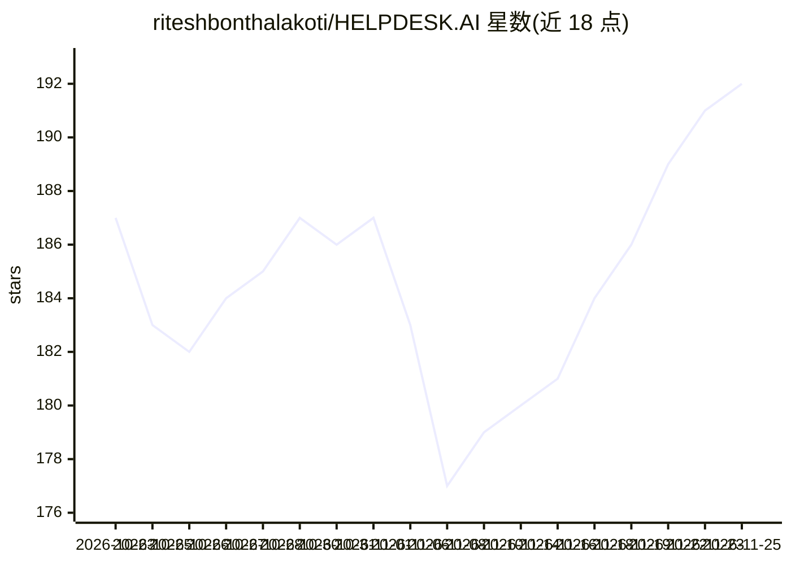

# riteshbonthalakoti/HELPDESK.AI

⭐ 192 · Python · MIT · 推送 2026-11-23 · [GitHub](https://github.com/riteshbonthalakoti/HELPDESK.AI) · [官网](https://riteshbonthalakoti.tech/projects/helpdesk-ai) · 个人维护

**给工程团队的开源 AI 工单平台：自动分级、去重与方案合成**

全栈工单平台（FastAPI 后端 + React 19 前端 + Expo 移动端），对新工单执行自动分类分级（DistilBERT v3 输出 P1–P4 严重度与工程领域）、截图/堆栈的 Tesseract OCR 与 NER 实体抽取、基于 Sentence Transformers 向量相似度的重复工单聚类，并可生成解决建议。支持本地模型运行（DistilBERT、all-MiniLM-L6-v2、Ollama）或接入云端 LLM 提供商。提供 Docker Compose 一键启动、云 Demo 与降级启动模式（模型权重缺失时用确定性规则兜底）。MIT 许可。

## 筛选速览

| 维度 | 判定 | 备注 |
|---|---|---|
| AI 角色 | `ai-native` | 本体是模型或模型工具 |
| 许可风险 | `permissive` | MIT |
| 部署形态 | `self-host` | docker 或自建部署 |
| 模型依赖 | local-ok | 支持本地模型 |
| 硬件要求 | — | 无带数字的原话,不猜 |
| 安装摩擦 | `low` | 无编译、无系统依赖或容器化 |
| 成熟度 | — | 结构信号不足 |

## 能力要点

- DistilBERT v3 毫秒级工单分级（P1–P4）与领域分类
- Tesseract OCR + transformer NER 从截图/日志抽取主机名、IP、错误码
- 384 维向量嵌入实时聚类重复工单，合并为主事件
- 本地模型或云端 LLM 可选，PII 正则脱敏后再入索引

## 适用场景

- IT 支持团队自动分级与路由工单
- 故障期间合并重复上报、避免工单洪泛
- 从错误截图自动抽取错误码与堆栈信息

## 场景标签

`OCR` · 领域:感知与多模态

## 证据(README 行号)

> L3:  The Open-Source AI Helpdesk for Modern Engineering Teams
> L31:  DistilBERT v3 classifies incoming tickets into severity tiers (P1 to P4) and engineering domains in under 50 ms. U

## 星数曲线

2026-10-23 187 → 2026-11-25 192（+5）

---
*卡片 v1 · prompt 1.4 · 生成 2026-11-25 · 置信度 high · 依据 README sha `36e831059a7c` · [字段定义](../../DATASET.md)*
