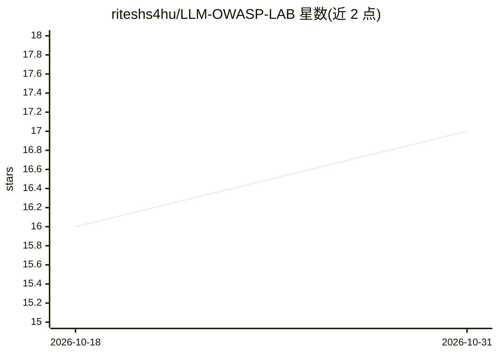

# riteshs4hu/LLM-OWASP-LAB

⭐ 17 · CSS · 推送 2026-09-16 · [GitHub](https://github.com/riteshs4hu/LLM-OWASP-LAB) · 个人维护

**OWASP LLM Top 10 安全学习靶场：可运行的漏洞实验应用**

面向学习 LLM 安全的开发者与安全研究者的动手实验集合：按 OWASP Top 10 for LLM Applications 组织 18 个已完成的漏洞挑战（覆盖提示注入、敏感信息泄露、系统提示泄露、无限消耗等），每个挑战是独立应用，含各自的安装说明与 README。运行依赖本地 Ollama 提供模型（工具类实验需支持 Tool Calling 的模型），也可改用 Ollama Cloud 模型；支持源码运行与 Docker 镜像两种启动方式，环境变量可配置模型与主机端口。供应链与幻觉两项挑战尚未发布。

## 筛选速览

| 维度 | 判定 | 备注 |
|---|---|---|
| AI 角色 | `ai-knowledge` | 知识聚合/清单类 |
| 许可风险 | `none` | — |
| 部署形态 | `self-host` | docker 或自建部署 |
| 模型依赖 | local-ok | 支持本地模型 |
| 硬件要求 | — | 无带数字的原话,不猜 |
| 安装摩擦 | `low` | 无编译、无系统依赖或容器化 |
| 成熟度 | — | 结构信号不足 |

## 能力要点

- 覆盖 OWASP LLM Top 10 中 8 类漏洞共 18 个已完成挑战
- 每个挑战自包含，可通过源码或 Docker 镜像本地运行
- 模型由 Ollama 本地提供，弱机器可切换 Ollama Cloud 模型
- Docker 镜像支持模型/主机/端口四个位置参数或环境变量配置

## 适用场景

- 通过靶场实验学习 OWASP LLM Top 10 各类漏洞的成因
- 安全培训或自学中动手测试提示注入、信息泄露等漏洞
- 本地搭建 LLM 攻防实验环境进行练习

## 场景标签

`网络安全` `教程课程` · 领域:学习与行业

## 证据(README 行号)

> L3: A collection of intentionally vulnerable AI/LLM applications for learning LLM security through hands-on labs.
> L5: The goal of this project is to cover the vulnerabilities from the OWASP Top 10 for LLM Applications with practical c

## 星数曲线

2026-10-18 16 → 2026-10-31 17（+1）

---
*卡片 v1 · prompt 1.4 · 生成 2026-10-30 · 置信度 high · 依据 README sha `d3549b85fa70` · [字段定义](../../DATASET.md)*
