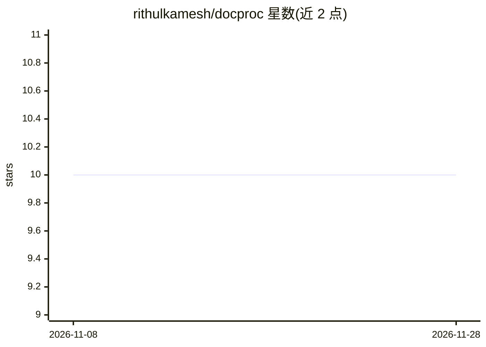

# rithulkamesh/docproc

⭐ 10 · Python · MIT · 推送 2026-04-08 · [GitHub](https://github.com/rithulkamesh/docproc) · 个人维护

**为 AI 流水线把文档转成结构化 Markdown 的提取引擎**

docproc 是文档到 Markdown 的提取引擎，将 PDF、DOCX、PPTX、XLSX 转为结构化 Markdown，保留公式、图表与嵌入图像。机制上优先使用原生提取器（PyMuPDF、python-docx 等），对 PDF 嵌入图像逐张运行视觉模型生成描述或 LaTeX，可选 LLM 精炼步骤整理 Markdown 并规范化数学。提供 CLI 与可导入的 Python 库两种形态，配置经 docproc.yaml 或 init-config 从 .env 生成，定位为 LLM/RAG 管线的上游组件，无内置服务器或数据库。

## 筛选速览

| 维度 | 判定 | 备注 |
|---|---|---|
| AI 角色 | `ai-native` | 本体是模型或模型工具 |
| 许可风险 | `permissive` | MIT |
| 部署形态 | `library` | 以包/库形式分发 |
| 模型依赖 | — | README 未给出锁定关系 |
| 硬件要求 | — | 无带数字的原话,不猜 |
| 安装摩擦 | `low` | 无编译、无系统依赖或容器化 |
| 成熟度 | — | 结构信号不足 |

## 能力要点

- 支持 PDF/DOCX/PPTX/XLSX 转 Markdown，保留公式与图表
- PDF 每张嵌入图像经视觉模型生成描述、LaTeX 或结构化说明
- 可选 LLM 精炼阶段整理 Markdown、规范化 LaTeX
- CLI 与 Python 库双形态，PEP 561 类型标注

## 适用场景

- 把论文 PDF 转成含 LaTeX 公式的 Markdown 供 LLM 使用
- 为 RAG 系统批量准备结构化文档语料
- 解析含图表的 PPTX/XLSX 并生成图像文字说明

## 场景标签

`文档解析` · 领域:知识与检索

## 证据(README 行号)

> L10: docproc is a document-to-markdown extraction engine. It converts PDFs, DOCX, PPTX, and XLSX into clean structured m
> L88: 1. **Load** — Read the file (PDF/DOCX/PPTX/XLSX) and extract full text from the native layer.
> L93: Configuration lives in `docproc.yaml` (or generated via `docproc init-config --env .env`). AI providers: OpenAI, Az

## 星数曲线

2026-11-08 10 → 2026-11-28 10（+0）

---
*卡片 v1 · prompt 1.4 · 生成 2026-11-19 · 置信度 high · 依据 README sha `f1114fdc1299` · [字段定义](../../DATASET.md)*
