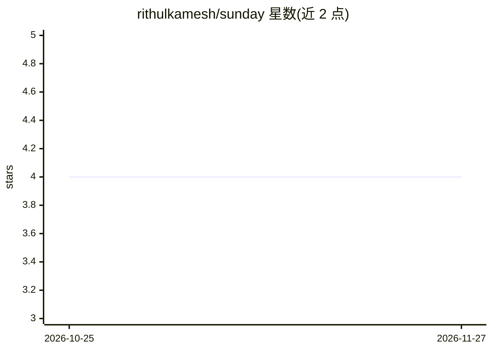

# rithulkamesh/sunday

⭐ 4 · Rust · GPL-3.0 · 推送 2026-11-13 · [GitHub](https://github.com/rithulkamesh/sunday) · [官网](http://sunday.rithul.dev/) · 个人维护

**本地优先的语音/屏幕 agent harness 实验项目**

Sunday 是一个开放的实验性 agent harness，围绕可替换模型封装语音与屏幕前端、长期记忆、技能库与动作层，核心假设是规划-验证-记忆-学习的循环能让模型持续提升能力。它以固定的 50 任务评测套件作为量化目标（v1 目标 ≥70% 通过率），每次 PR 运行含提示注入红队的评测。当前状态为早期软件，仅支持 macOS，默认运行 4B 本地模型，动作为分级审批与审计日志约束。

## 筛选速览

| 维度 | 判定 | 备注 |
|---|---|---|
| AI 角色 | `ai-native` | 本体是模型或模型工具 |
| 许可风险 | `viral` | GPL-3.0 |
| 部署形态 | `None` |  |
| 模型依赖 | local-ok | 支持本地模型 |
| 硬件要求 | — | 无带数字的原话,不猜 |
| 安装摩擦 | `low` | 无编译、无系统依赖或容器化 |
| 成熟度 | `idea` | |

## 能力要点

- 语音+屏幕输入，每条话语路由为一个类型化 Action，含分级审批与审计日志
- 本地 OCR、视觉模型识图、唤醒词与声纹识别
- 可换模型后端：Ollama、MLX 或托管模型，数据 SQLite 本地存储
- 评测驱动：带沙箱的 eval 套件与提示注入红队测试在每次 PR 运行

## 适用场景

- 在本机跑一个隐私优先的语音/屏幕 agent 日常助手
- 研究 harness 循环（规划/验证/记忆）对模型能力的增益
- 用固定评测套件跟踪 agent 任务的通过率变化

## 场景标签

`语音 Agent` `GUI 自动化` `Agent 记忆` `模型评测` · 领域:Agent 开发

## 证据(README 行号)

> L13: Sunday is an open experiment to find out. It is a local-first agent harness: a voice and screen front end, a memory
> L17: > **v1 bar:** Sunday completes open-ended, multi-day goals on your own machine with no hand-holding, scoring **>= 7
> L43: |**Decides**|Every utterance becomes one typed `Action`; a deterministic rules router, plus an optional on-device d

## 星数曲线

2026-10-25 4 → 2026-11-27 4（+0）

---
*卡片 v1 · prompt 1.4 · 生成 2026-11-21 · 置信度 high · 依据 README sha `bd9b785d0c5c` · [字段定义](../../DATASET.md)*
