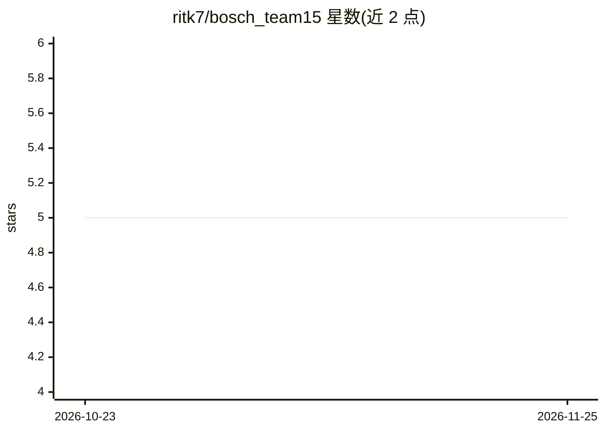

# ritk7/bosch_team15

⭐ — · [GitHub]() · 个人维护

**对 Docker Compose 应用做 AI 混沌工程实验的工具**

面向 Bosch Eclipse hawkBit 等 Docker Compose 应用的混沌工程工具：映射服务依赖并构建数字孪生，由三个 AI agent（Planner/Risk/Fix）排序实验并预测损伤，在代码实现的 kill switch 保护下注入崩溃、挂起、网络延迟、数据库过载等故障，逐 id 核对工作单元丢失情况，给出排序发现、修复建议与韧性评分，重跑验证修复。护栏为代码而非模型（错误率、p95、爆炸半径、时长上限）。模型为可选项，规则兜底，无模型也能运行。

## 筛选速览

| 维度 | 判定 | 备注 |
|---|---|---|
| AI 角色 | `ai-enhanced` | 去掉 AI 部分产品仍成立 |
| 许可风险 | `permissive` | — |
| 部署形态 | `self-host` | docker 或自建部署 |
| 模型依赖 | — | README 未给出锁定关系 |
| 硬件要求 | — | 无带数字的原话,不猜 |
| 安装摩擦 | `low` | 无编译、无系统依赖或容器化 |
| 成熟度 | `idea` | |

## 能力要点

- 闭环流程：映射→数字孪生演练→AI 规划预测→带护栏注入→逐 id 核验→恢复→解释修复→重跑证明
- 代码护栏：错误率≥60%、p95≥max(3s,10×基线)、爆炸半径与 45 秒上限触发即恢复
- 支持 SIGKILL 崩溃、挂起、断网、tc netem 延迟丢包、CPU 限流、数据库过载等故障类型
- 可选接入 OpenAI 兼容路由或 Anthropic API，规则优先、响应缓存与成本账本

## 适用场景

- 对 OTA 更新服务器（hawkBit）等 Compose 应用做故障注入实验
- 在数字孪生上演练全部实验目录，找出排名靠前的薄弱服务
- 以韧性评分作为 CI 门禁（--min-score）
- 将 Prometheus/Grafana 接入观测注入过程的指标

## 场景标签

`工作流自动化` · 领域:效率与自动化

## 证据(README 行号)

> L5: **An AI that predicts what a failure will do, breaks your app safely behind a kill switch that is plain code, proves
> L21: |**3 AI agents**|Planner (ranks experiments with reasons, predicts the damage), Risk (ranked findings), Fix (concre
> L44: |Low cost|Rules first, small model second (Claude Haiku via an OpenAI-compatible router), response cache, cost ledg

## 星数曲线

2026-10-23 5 → 2026-11-25 5（+0）

---
*卡片 v1 · prompt 1.4 · 生成 2026-11-21 · 置信度 mid · 依据 README sha `1233241d2099` · [字段定义](../../DATASET.md)*
