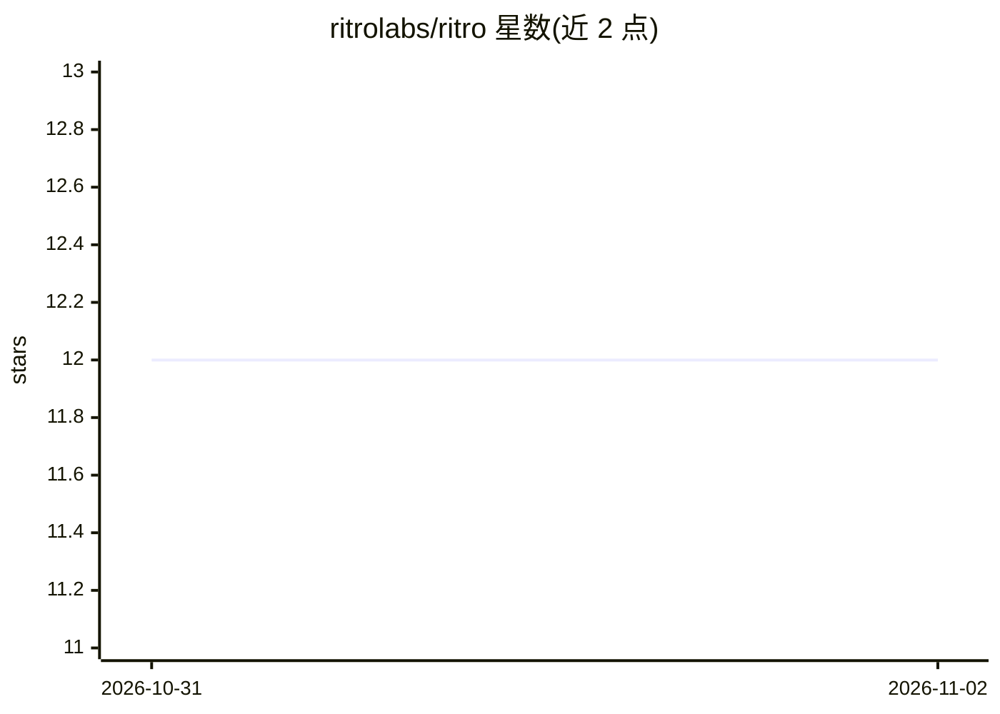

# ritrolabs/ritro

⭐ 12 · TypeScript · AGPL-3.0 · 推送 2026-10-31 · [GitHub](https://github.com/ritrolabs/ritro) · [官网](https://ritro.vercel.app) · 组织维护

**个人书签归档工具：AI 自动打标签并每日回送旧收藏**

面向个人用户的全栈书签管理应用：通过网站、Chrome 扩展或 bookmarklet 一键保存链接，系统读取页面标题、描述与预览图，异步调用 Gemini 生成 3-5 个标签，支持集合整理与跨标题/描述/标签的搜索。每日定时任务将最多 5 条历史收藏邮件回送给用户，仪表盘提供随机取回功能。技术栈为 Next.js 16 + Supabase/PostgreSQL + Upstash 队列，部署于 Vercel。可在线使用，也可本地运行（需 Node.js 20+、Supabase、Gemini API key、Upstash Redis），AGPL-3.0 许可，支持 JSON 导出与账号删除。

## 筛选速览

| 维度 | 判定 | 备注 |
|---|---|---|
| AI 角色 | `ai-enhanced` | 去掉 AI 部分产品仍成立 |
| 许可风险 | `viral` | AGPL-3.0 |
| 部署形态 | `library` | 以包/库形式分发 |
| 模型依赖 | — | README 未给出锁定关系 |
| 硬件要求 | — | 无带数字的原话,不猜 |
| 安装摩擦 | `low` | 无编译、无系统依赖或容器化 |
| 成熟度 | — | 结构信号不足 |

## 能力要点

- 保存后由 Gemini 生成 3-5 个标签，经 QStash 队列异步处理并带重试与补打标签任务
- 每日 08:00 定时邮件回送最多 5 条历史收藏，另有随机取回功能
- Chrome 扩展（Alt+Shift+S 快捷键）、bookmarklet 与网站三种保存入口
- 保存前校验链接为公网地址（含重定向复查），行级安全策略隔离数据

## 适用场景

- 把想回头看的链接一键存档，不依赖手动整理
- 每天收邮件重温被遗忘的收藏
- 按记得的关键词或标签/集合筛选查找旧链接

## 场景标签

`知识库管理` · 领域:知识与检索

## 证据(README 行号)

> L22: - **It files itself.** Ritro reads each page's title, description and preview image, and a few seconds later Gemini
> L96: Without them, bookmarks still save; they just don't get AI tags.

## 星数曲线

2026-10-31 12 → 2026-11-02 12（+0）

---
*卡片 v1 · prompt 1.4 · 生成 2026-11-01 · 置信度 high · 依据 README sha `44b2ca6450c3` · [字段定义](../../DATASET.md)*
