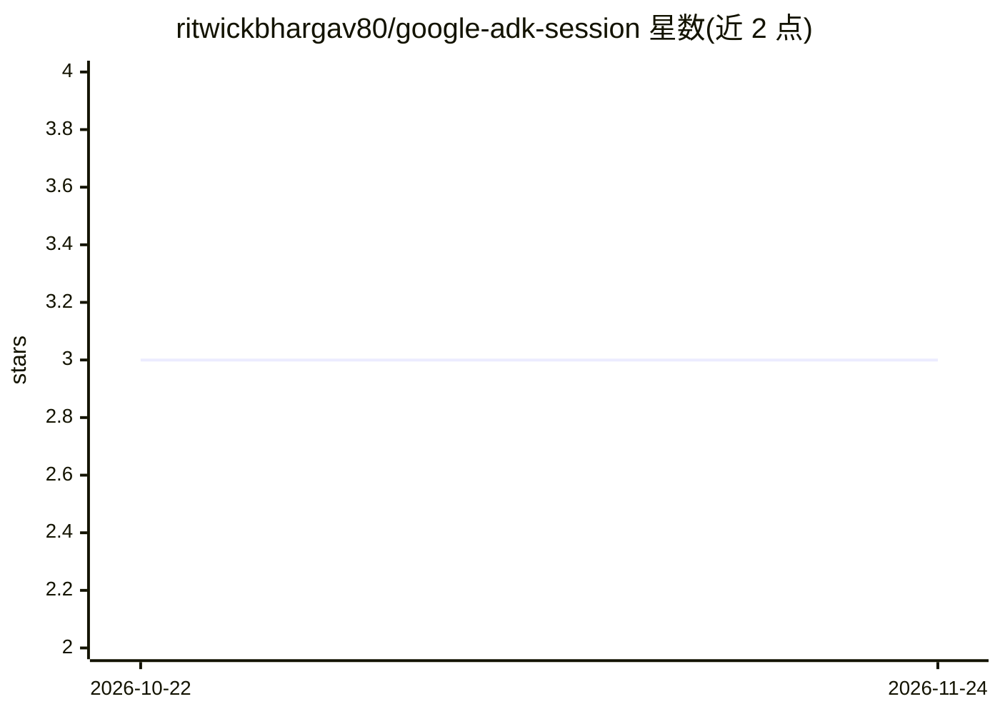

# ritwickbhargav80/google-adk-session

⭐ 3 · Python · 推送 2026-10-17 · [GitHub](https://github.com/ritwickbhargav80/google-adk-session) · 个人维护

**ADK 周末行程规划 agent：基于 MongoDB 向量检索生成行程**

一个 Google ADK agent，工作流程为：用 gemini-embedding-001 嵌入用户查询，从 MongoDB Atlas Vector Search 检索活动、地点与美食数据，再由 gemini-3.5-flash 仅基于检索结果生成行程。README 提供 11 步部署流程：Python 虚拟环境、pip 依赖安装（需固定 OpenTelemetry 版本）、Gemini API key 与 Atlas 免费版集群配置、向量索引创建、数据注入、检索测试与 agent 运行，并附故障排查表与可选评测步骤。

## 筛选速览

| 维度 | 判定 | 备注 |
|---|---|---|
| AI 角色 | `ai-native` | 本体是模型或模型工具 |
| 许可风险 | `none` | — |
| 部署形态 | `desktop` | 安装包/桌面程序 |
| 模型依赖 | — | README 未给出锁定关系 |
| 硬件要求 | — | 无带数字的原话,不猜 |
| 安装摩擦 | `low` | 无编译、无系统依赖或容器化 |
| 成熟度 | — | 结构信号不足 |

## 能力要点

- gemini-embedding-001 嵌入 + Atlas Vector Search 检索 + gemini-3.5-flash 生成行程
- ingest.py 从 JSON 数据文件嵌入并写入向量库，支持重新注入
- 提供检索测试脚本与 adk eval 评测集（含当前评测集无法通过默认阈值的说明）
- 免费的 Atlas M0 层即可运行，Gemini 免费档限 5 请求/分钟

## 适用场景

- 为自己所在城市的周末安排生成个性化行程
- 学习 ADK + RAG + 向量检索的完整搭建流程
- 对检索质量用脚本和评测集做验证

## 场景标签

`RAG` · 领域:知识与检索

## 证据(README 行号)

> L7: Plan My Weekend is a Google ADK agent. For each request it:
> L9: 1. Embeds the user's query with `gemini-embedding-001`.
> L10: 2. Retrieves matching activities, places and food from MongoDB Atlas Vector Search.
> L11: 3. Builds an itinerary with `gemini-3.5-flash`, using only the retrieved data.

## 星数曲线

2026-10-22 3 → 2026-11-24 3（+0）

---
*卡片 v1 · prompt 1.4 · 生成 2026-11-21 · 置信度 high · 依据 README sha `7b7668383d23` · [字段定义](../../DATASET.md)*
