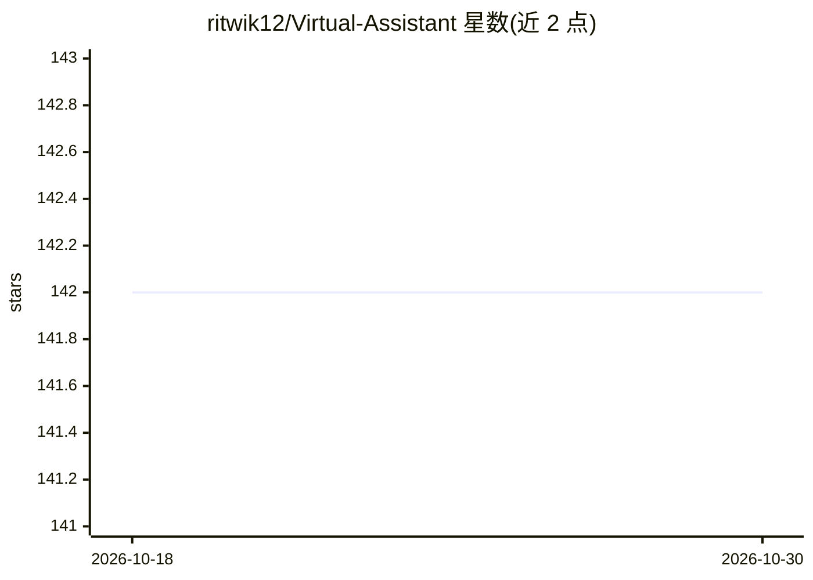

# ritwik12/Virtual-Assistant

⭐ 142 · C · GPL-3.0 · 推送 2026-07-25 · [GitHub](https://github.com/ritwik12/Virtual-Assistant) · 个人维护

**Linux 命令行虚拟助手：NLP 匹配语句执行任务**

用 C 语言编写的 Linux/macOS 命令行虚拟助手：读取用户输入语句，经简化的多项式朴素贝叶斯算法分类，将语句映射到对应动作，包括天气查询、播放媒体、打开应用与目录、Google/YouTube 搜索、日历、餐厅查找、Gmail 发信、提醒与日程、算术计算等；无法理解语句时回退到 Google 搜索。通过 GNUstep/Espeak 提供文本转语音，用 make 或 gcc 从源码编译安装，需要安装 libcurl、json-c、openssl 等系统依赖。

## 筛选速览

| 维度 | 判定 | 备注 |
|---|---|---|
| AI 角色 | `ai-native` | 本体是模型或模型工具 |
| 许可风险 | `viral` | GPL-3.0 |
| 部署形态 | `None` |  |
| 模型依赖 | — | README 未给出锁定关系 |
| 硬件要求 | — | 无带数字的原话,不猜 |
| 安装摩擦 | `medium` | 含编译或系统依赖之一 |
| 成熟度 | — | 结构信号不足 |

## 能力要点

- 简化的多项式朴素贝叶斯算法做语句分类
- 覆盖天气、媒体、搜索、日历、邮件、日程、计算等任务
- 无法识别的语句自动回退 Google 搜索
- GNUstep/Espeak 文本转语音输出

## 适用场景

- 在终端用自然语句执行系统操作，如打开应用或搜索
- 让助手查天气、看日历、做算术计算
- 通过命令行收发提醒与日程通知

## 场景标签

`AI 助手` · 领域:对话与助手

## 证据(README 行号)

> L12: Virtual assistants use Artificial Intelligence to match user text input to executable commands.
> L31: The user's sentence is read and passed through our Natural Language Processing (NLP) code for processing. After the
> L49: Each classification contains a set of sentences that inputs are matched to. Scores are assigned based on the occurr

## 星数曲线

2026-10-18 142 → 2026-10-30 142（+0）

---
*卡片 v1 · prompt 1.4 · 生成 2026-10-22 · 置信度 high · 依据 README sha `15347ce87f55` · [字段定义](../../DATASET.md)*
