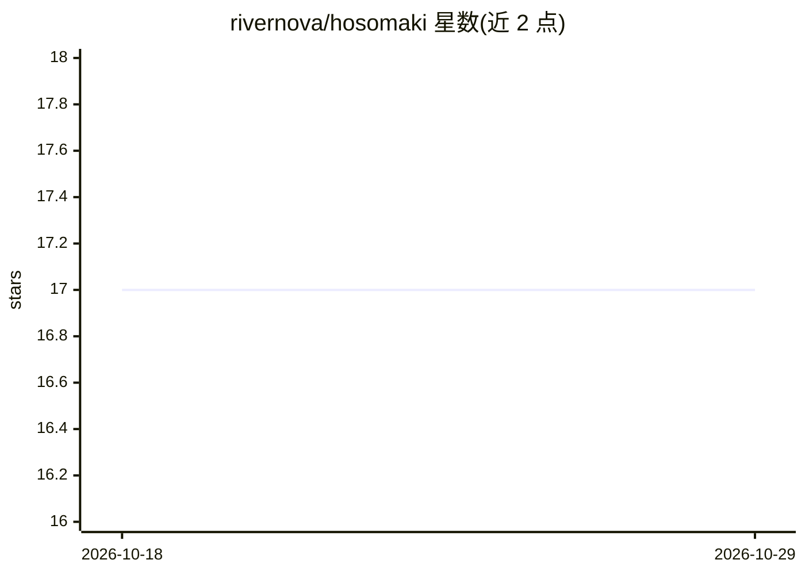

# rivernova/hosomaki

⭐ 17 · Go · MPL-2.0 · 推送 2026-10-18 · [GitHub](https://github.com/rivernova/hosomaki) · 个人维护

**面向 Linux 的本地 AI 系统诊断 CLI，用自然语言解释系统状态**

用 Go 编写的 Linux 命令行工具，读取 systemd 服务、日志、端口、定时器、crontab、挂载点、防火墙规则与待更新包等系统信息，经本地 Ollama 模型处理后以自然语言输出解释与诊断建议（doctor/why/audit/watch 等 14 个命令）。面向管理 systemd 发行版的用户与运维人员。所有数据本地处理，发送模型前经强制净化层剥离 IP、主机名、路径、UUID、邮箱与凭据；响应经 schema 校验修复后渲染。当前为 v0.5.0 pre-1.0.0，flags 与配置未冻结。

## 筛选速览

| 维度 | 判定 | 备注 |
|---|---|---|
| AI 角色 | `ai-native` | 本体是模型或模型工具 |
| 许可风险 | `permissive` | MPL-2.0 |
| 部署形态 | `None` |  |
| 模型依赖 | local-ok | 支持本地模型 |
| 硬件要求 | — | 无带数字的原话,不猜 |
| 安装摩擦 | `low` | 无编译、无系统依赖或容器化 |
| 成熟度 | `idea` | |

## 能力要点

- 14 个系统诊断命令（explain/doctor/why/audit/watch/firewall 等）
- 强制数据净化层剥离 IP/主机名/路径/UUID/邮箱/凭据后送本地模型
- 仅依赖本地 Ollama，数据不出机器
- 提供 .deb/.rpm 包与源码构建两种安装方式

## 适用场景

- 排查 systemd 服务报错并理解失败链路
- 日常巡检：快速了解系统健康与异常端口/定时器/挂载
- 审计基线快照以来的系统变更
- shell 集成后自动解释失败命令

## 场景标签

 · 领域:系统运维/可观测性

## 证据(README 行号)

> L7: It uses a local model via Ollama and never sends anything off your machine.
> L15: |`explain`|Explain errors from a service, boot, log file, pipe, inline text, or a running process|
> L43: Hosomaki is designed around a simple principle: your data should remain yours. Before anything reaches the local mo

## 星数曲线

2026-10-18 17 → 2026-10-29 17（+0）

---
*卡片 v1 · prompt 1.4 · 生成 2026-10-29 · 置信度 high · 依据 README sha `591d3ef55b58` · [字段定义](../../DATASET.md)*
