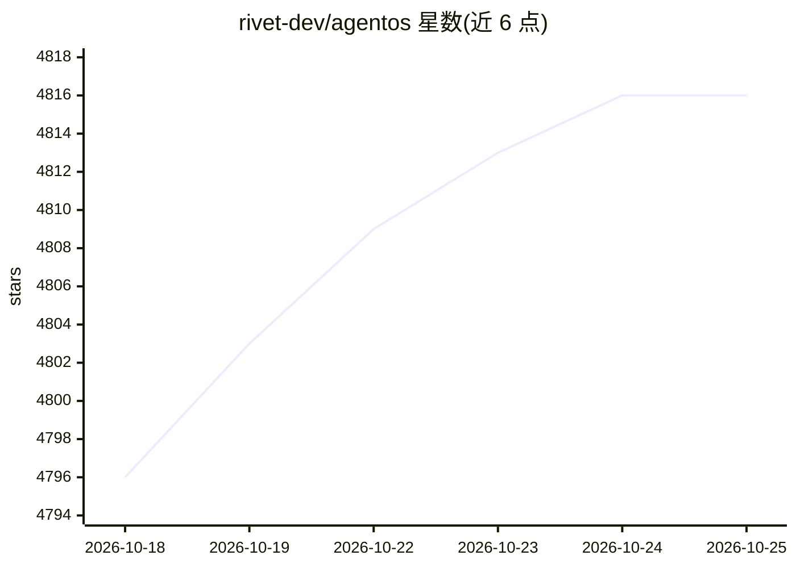

# rivet-dev/agentos

⭐ 4,820 · Rust · Apache-2.0 · 推送 2026-10-23 · [GitHub](https://github.com/rivet-dev/agentos) · [官网](https://rivet.dev/agentos) · 组织维护

**面向 AI agent 的 WebAssembly 轻量沙箱运行时库**

基于 WebAssembly 与 V8 isolates 的沙箱库，为每个 agent 提供含 POSIX 文件系统、进程、shell 与网络的 Linux 兼容环境，默认隔离主机访问，通过 mounts/宿主函数/网络权限选择性放开。以 npm 库形式嵌入后端进程运行，由 Rust sidecar 进程持有内核；亦可通过 HTTP API 以 Rivet Cloud 托管或自托管方式使用。支持在沙箱内运行 JavaScript、TypeScript、Python 及进程、文件、网络、定时任务等 API 组。

## 筛选速览

| 维度 | 判定 | 备注 |
|---|---|---|
| AI 角色 | `ai-ecosystem` | LLM/agent 周边工具 |
| 许可风险 | `permissive` | Apache-2.0 |
| 部署形态 | `library` | 以包/库形式分发 |
| 模型依赖 | — | README 未给出锁定关系 |
| 硬件要求 | — | 无带数字的原话,不猜 |
| 安装摩擦 | `low` | 无编译、无系统依赖或容器化 |
| 成熟度 | — | 结构信号不足 |

## 能力要点

- WebAssembly + V8 isolates 实现 Linux 兼容沙箱，无需 hypervisor 或嵌套虚拟化
- npm 库形式嵌入后端进程，或经 HTTP API 托管在 Rivet Cloud/自托管
- Rust sidecar 进程持有内核，guest 代码经 syscall 访问且默认无法触及主机文件/进程/网络
- 提供进程、终端、文件系统、JS/TS/Python 执行、网络与 cron 等 API 组

## 适用场景

- 在后端进程中为 AI agent 提供隔离的执行环境
- 在不暴露原始密钥的前提下让 agent 调用可信宿主函数
- 托管运行不可信 agent 代码并施加资源与权限限制

## 场景标签

 · 领域:AI agent 基础设施/沙箱运行时

## 证据(README 行号)

> L7:  Tiny, fast, Linux-compatible sandboxes. Powered by WebAssembly.
> L23: - **Library, not extra infrastructure.** Install agentOS from npm and run it inside the backend process you already
> L25: - **Direct function calls, not extra APIs.** Connect agents to your application with ordinary JavaScript calls inst

## 星数曲线

2026-10-18 4,796 → 2026-10-25 4,816（+20）

---
*卡片 v1 · prompt 1.4 · 生成 2026-10-20 · 置信度 high · 依据 README sha `fc81670137e7` · [字段定义](../../DATASET.md)*
