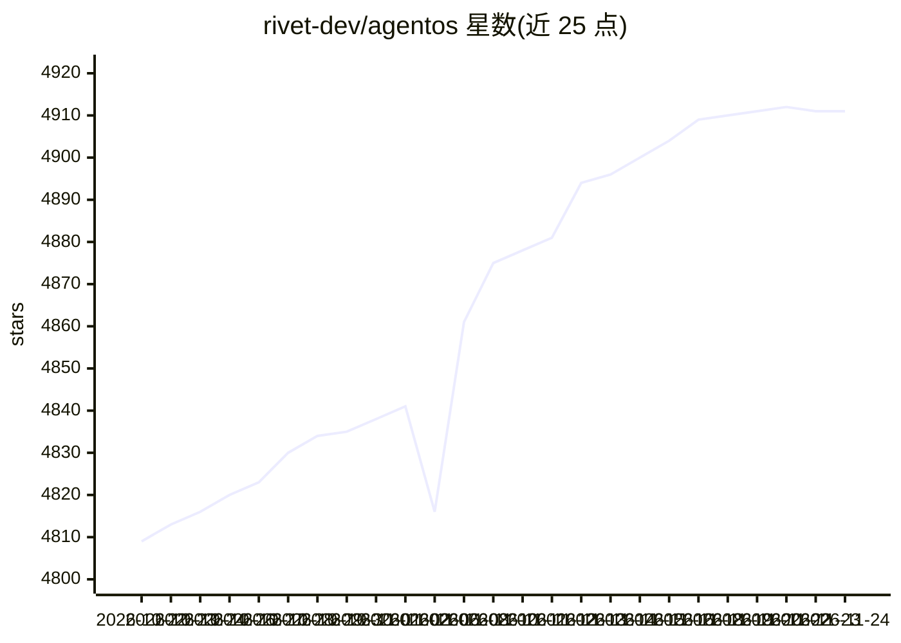

# rivet-dev/agentos

⭐ 4,918 · Rust · Apache-2.0 · 推送 2026-11-23 · [GitHub](https://github.com/rivet-dev/agentos) · [官网](https://rivet.dev/agentos) · 组织维护

**为 AI agent 提供隔离沙箱的轻量 Linux 兼容 VM 运行时**

agentOS 是一个基于 WebAssembly 的轻量 Linux 兼容 VM 运行时，提供隔离的文件系统、进程、终端、语言运行时与网络负载。以两种形式提供：作为 Rivet actor 托管运行并通过生成的 TypeScript 契约访问，或以 @rivet-dev/agentos 嵌入受信任的 Node.js 应用。托管形式仅接受可序列化、白名单化的文件系统描述符；软件以不可变 .aospkg 工件按 digest 内容寻址安装。面向需要为 agent 构建沙箱执行环境的开发者。

## 筛选速览

| 维度 | 判定 | 备注 |
|---|---|---|
| AI 角色 | `ai-ecosystem` | LLM/agent 周边工具 |
| 许可风险 | `permissive` | Apache-2.0 |
| 部署形态 | `library` | 以包/库形式分发 |
| 模型依赖 | — | README 未给出锁定关系 |
| 硬件要求 | — | 无带数字的原话,不猜 |
| 安装摩擦 | `low` | 无编译、无系统依赖或容器化 |
| 成熟度 | — | 结构信号不足 |

## 能力要点

- 隔离文件系统、进程、终端、语言与网络负载的 VM 运行时
- Rust actor 托管形式与 Node.js 嵌入式 Core 两种使用方式
- 不可变 .aospkg 软件工件，按 sha256 digest 内容寻址缓存
- V8 为默认 WASM 后端，可选 Wasmtime 执行器

## 适用场景

- 为 AI agent 提供隔离的代码执行沙箱
- 在 Node.js 应用中嵌入可编程 VM 环境
- 托管运行终端/文件系统/网络类工作负载

## 场景标签

`Agent 框架` · 领域:Agent 开发

## 证据(README 行号)

> L3: agentOS is a lightweight Linux-compatible VM runtime for isolated filesystem,
> L8: - a fixed Rust Rivet actor named `agentOS`, accessed through a generated

## 星数曲线

2026-10-22 4,809 → 2026-11-24 4,911（+102）

---
*卡片 v1 · prompt 1.4 · 生成 2026-11-22 · 置信度 mid · 依据 README sha `4bcb6e66d605` · [字段定义](../../DATASET.md)*
